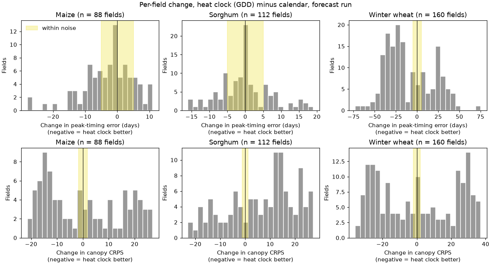
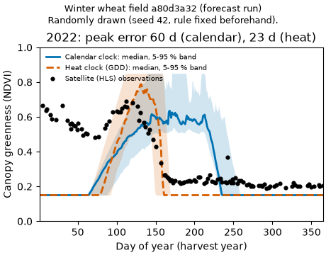
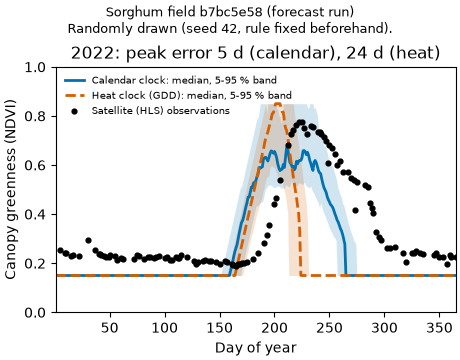

# Calendar clock vs heat clock: what changed in the predictions

*12 Nov 2026. Experiment on branch `experiment/algo-upgrade`, not part of the live website. All numbers come from `results/hindcast/gdd_before_after/summary.md`; that file also gives every confidence range.*

## What we changed

The model has to know how far along a crop is: just sown, growing, fully green, or drying off. Until now it counted **calendar days** from sowing. A crop takes the same number of days in every year, warm or cold.

In this experiment the model counts **heat** instead ("growing degree days"). A warm week moves the crop on faster than a cold week. The heat needed for each growth stage comes from Kansas State University extension publications. For winter wheat the heat count starts on 1 January, as the Kansas Mesonet wheat tool does. Nothing else was changed or re-tuned.

We tested both clocks on the same 463 field-seasons from 2022–2024 (maize 124, sorghum 142, winter wheat 197). The model only saw data up to the end of 2021. The forecast run uses past weather, like a farmer planning in January. The forced run uses the real weather of the season.

## What got better

- **Winter wheat timing.** The old model put the wheat's green peak far too late: 36 days late for the median season. With the heat clock the median season is 8 days late. The average size of the timing error fell from 58.9 to 49.4 days in the forecast run, and from 71.8 to 44.4 days in the forced run.
- **Maize timing, a little.** The average timing error fell from 14.9 to 12.8 days.

## What got worse

- **Sorghum greenness over the season.** This score is the canopy CRPS; lower is better. It got clearly worse: from 12.4 to 19.2. The 90 % ranges caught the real value in 19 % of seasons, down from 44 %. Field by field, 76 of 112 sorghum fields got worse on this score and 33 got better.
- **Confidence ranges for timing.** These became too narrow for maize and sorghum. The observed peak fell inside the 90 % range in 74 % of maize seasons, down from 93 %.
- **Against the simplest baseline.** "Just use this field's past seasons" (B0) needs no model at all. With the heat clock, B0 beats FieldWitness on sorghum greenness. With the calendar clock, FieldWitness beats B0 on sorghum. For maize the difference is unclear with either clock.
- **The wheat gain is not steady from year to year.** Wheat timing improved by about 26 days in 2022 and 22 days in 2024. It got **worse by 21 days in 2023**. Field by field, 95 wheat fields improved and 50 got worse.

*Each bar counts fields. Left of the black line means the heat clock was better. The yellow strip is the "no real change" band we fixed before looking.*

 

*Two of the eight fields drawn at random by a rule written before looking. Black dots are satellite readings. Blue is the calendar clock and dashed orange the heat clock; shading shows the model's 5–95 % range. On the wheat field the heat clock finds the spring peak. On the sorghum field the heat-clock season ends weeks before the satellite sees the crop fade. All charts are in `results/hindcast/gdd_before_after/figures/`. The "after the fact" charts were picked after seeing the results, so they are illustrations, not evidence.*

## What we cannot conclude

- **Why it happens.** The cause is not established: we did not test why wheat improved, why 2023 behaved differently, or why sorghum got worse. In the example charts the heat-clock sorghum season looks too short, but that is an observation, not a tested cause.
- **Yield or money.** Nothing here says anything about yield or profit. The scores only measure how well the model follows the satellite's view of green cover.
- **Other places.** These results come from one Kansas tile only.

## Why 2022–2024 no longer count as a clean test

We have now seen how both clocks did in 2022–2024. Any choice we make from here would be shaped by those years. That holds for keeping the heat clock for wheat only, or for changing the sorghum stage settings. Testing that choice on the same years would be like marking an exam after seeing the answers. A fair test needs seasons that played no part in the decision. The next clean test is 2025.

That data is not on this computer. About 175–185 MB of satellite data would be needed (an estimate), plus a 2025 crop map whose availability we have not checked. Nothing was downloaded.

## Recommendation

**Do not adopt the heat clock as it stands.** It fixes most of the winter wheat lateness, but it makes sorghum clearly worse and its wheat gain changes sign between years. A possible next step needs your decision: test "heat clock for winter wheat only", with all settings fixed in advance, on 2025 data.
