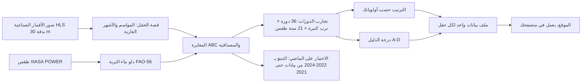
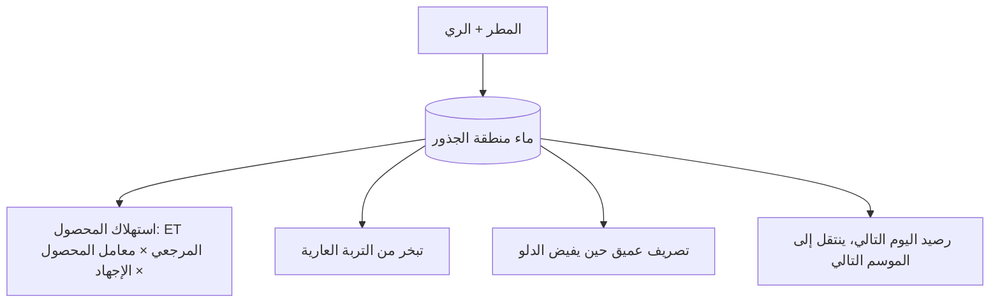
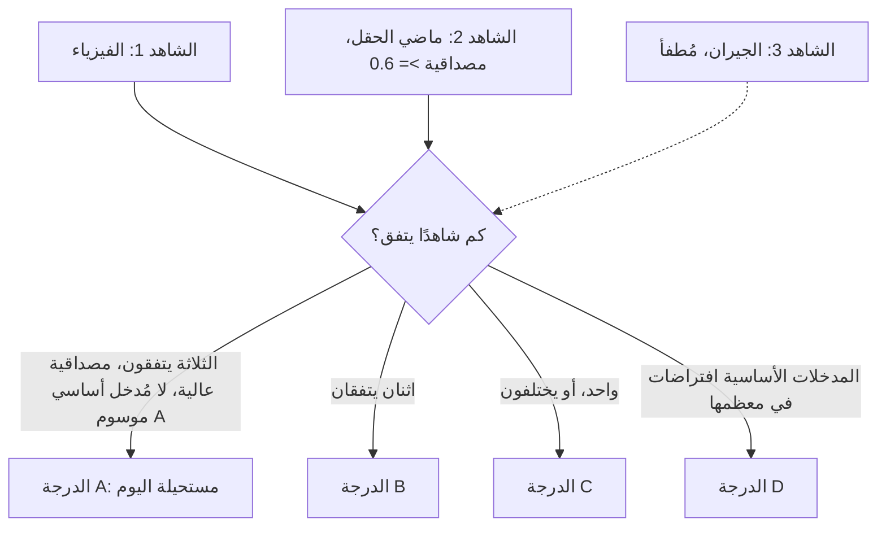

# كيف بُني FieldWitness، وكيف يعمل تنبؤه

> **تنبيه:** هذه مسودة مُعدّة بمساعدة الآلة، ولم يراجعها بعدُ متحدث أصلي باللغة العربية. النسخة الإنجليزية [HOW_WE_BUILT_FIELDWITNESS.en.md](HOW_WE_BUILT_FIELDWITNESS.en.md) هي المرجع عند أي اختلاف.

*دليل بلغة بسيطة لقارئ لا يكتب البرمجيات. كُتب في 12 Nov 2026 من سجلات المشروع نفسه: سجل git، و`PLAN.md`، و`DECISIONS.md`، و`results/`، و`config/`، و`src/`، و`app/`. حين تسكت السجلات يقول النص: «السجلات لا تذكر ذلك». توجد رواية أطول للبناء في [HOW_WE_BUILT_FIELDWITNESS.md](HOW_WE_BUILT_FIELDWITNESS.md).*

FieldWitness موقع مجاني يغطي 200 حقل زراعي حقيقي في ولاية كانساس بالولايات المتحدة. لكل حقل يعرض الموقع دورات زراعية ممكنة من ثلاثة مواسم (مثلًا: قمح شتوي، ثم ذرة رفيعة، ثم موسم بور)، ويرتبها، ويبيّن قوة الدليل على كل منها بدرجة من A إلى D. لا يقول لأحد ماذا يزرع. بُني لتحدي NASA Space Apps Challenge 2026، تحدي «Field Shift».

**من قام بالعمل.** حدد صاحب المشروع (المستخدم) الأهداف، واختار المناطق والنطاق، ووافق على كل حزمة برمجية جديدة، وكل تنزيل يزيد على 1 GB، وكل تغيير في شكل البيانات، وراجع كل نقطة تفتيش. كتب مساعدان برمجيان بالذكاء الاصطناعي معظم الشيفرة والوثائق تحت هذا التوجيه: Claude Code (من Anthropic)، ثم Google Antigravity (من Google) ابتداءً من 8 Nov 2026. يشير `PLAN.md` إلى «بحث تخطيطي» سابق، ينسبه تكليف هذه الوثيقة إلى مساعد محادثة؛ السجلات لا تذكر أي أداة قامت به ولا أي أجزاء الخطة جاءت منه. الموقع نفسه لا يحتوي على أي ذكاء اصطناعي: الترتيب يأتي من معادلات، والجمل من قوالب ثابتة.

**كيف تقرأ وسوم المصدر.** كل رقم في الموقع يحمل حرفًا واحدًا: **O** مُرصود بالقمر الصناعي، **D** مشتق بنموذج من بيانات الأقمار الصناعية، **E** بيانات خارجية من غير NASA، **A** افتراض وضعه الفريق.

- [الجزء A: كيف بُني، مرحلة بعد مرحلة](#part-a)
- [الجزء B: كيف تعمل الخوارزمية والتنبؤ](#part-b)

---

## الجزء A: كيف بُني، مرحلة بعد مرحلة

يتبع الترتيب أدناه سجل git (من 4 إلى 12 Nov 2026). تتداخل المراحل في الزمن لأن أشياء عدة بُنيت معًا. لكل مرحلة: التواريخ، والهدف، والخطوات، والسبب، وتشبيه من الحياة اليومية، والنتائج، وما الذي سار على نحو خاطئ، وأين تبحث.

| المرحلة | التواريخ (2026) | النتيجة الأساسية |
|---|---|---|
| 0 التحدي والفكرة | 4 Nov (العمل الأسبق غير مسجل) | خطة ببوابات؛ فكرة الشهود الثلاثة |
| 1 تجهيز المشروع | 4 Nov | الفحوص وفحص الأسرار تنجح على GitHub |
| 2 الوصول إلى البيانات | 4 Nov | كل مصدر اختُبر بطلب حقيقي واحد |
| 3 المنطقة والمحاصيل | 4 Nov | اختيار كانساس بالقياس؛ 11 محصولًا من FAO-56 |
| 4 الحقول وتواريخها | من 4 إلى 5 Nov | 200 حقل؛ 134,685 تاريخًا-حقليًا؛ 1,600 سنة-حقل موسومة |
| 5 قصة الحقل | 4 Nov | كشف المواسم 78.3% مقابل هدف 90% (لم يتحقق) |
| 6 دلو ماء التربة | 4 Nov | يعيد إنتاج المثال المحلول في FAO-56 |
| 7 المعايرة | 7 Nov | 185 من 200 حقل تحصل على درجة مصداقية |
| 8 محرك الدورات | من 7 إلى 8 Nov | 36 دورة مرتبة لكل حقل؛ الدرجات B وC وD فقط |
| 9 شاهد الجيران | من 7 إلى 8 Nov | 0 من 92 نجح؛ أُطفئ |
| 10 حزم الحقول | 4 و7 Nov | 200 حزمة تجتاز التحقق بلا مشاكل |
| 11 الموقع | من 4 إلى 7 Nov | خمس شاشات أساسية على بيانات حقيقية |
| 12 الاختبار على الماضي | من 7 إلى 8 Nov | تقدم صغير في 3 من 4 مقاييس؛ النطاقات ضيقة جدًا |
| 13 النشر | من 7 إلى 9 Nov | يعمل على GitHub Pages |
| 14 حاسوب ثانٍ ومساعد ثانٍ | 8 Nov | كل الاختبارات تنجح على الحاسوب الثاني |
| 15 التحسين الشكلي | 8 Nov | خريطة أساس، أسماء، مفتاح خريطة، وضع فاتح وداكن |
| 16 السرعة | من 8 إلى 9 Nov | تقليص شيفرة البداية بنسبة 84.7% |
| 17 ميزات وإصلاحات متأخرة | من 9 إلى 12 Nov | عرض ثلاثي الأبعاد، جولة، مُنشئ دورات، عرض المزرعة؛ نتائج سلبية أخرى معلنة |

### المرحلة 0: قراءة التحدي واختيار الفكرة
- **التواريخ:** 4 Nov. السجلات لا تذكر متى بدأ التفكير قبل ذلك.
- **الهدف:** تحويل التحدي الرسمي إلى خطة يستطيع فريق صغير ومساعدو ذكاء اصطناعي بناءها في أيام.
- **الخطوات:** نُسخ نص التحدي إلى `docs/official_challenge.md`؛ وضعت `PLAN.md` مراحل تنتهي كل منها بـ«بوابة» نجاح أو رسوب؛ راجعها Claude Code (الإصدار 1.1)؛ طابق الإصدار 1.2 الخطة مع التحدي سطرًا بسطر (الدورة الحالية هي الخيار 1، شروح من خمسة أجزاء، تقاويم، منزلقات للطقس)؛ ثُبتت قائمة «لا ندّعي أبدًا» (لا أطنان، لا خصوبة من الفضاء، لا أسعار ولا أرباح، لا ذكاء اصطناعي يقرر).
- **السبب:** بناء «أصغر عرض يبقى هو الفكرة الحقيقية» أولًا، من البداية إلى النهاية.
- **التشبيه:** قراءة سؤال الامتحان مرتين وكتابة مخطط قبل كتابة المقال.
- **النتائج:** خطة على مراحل ببوابات وقواعد ثابتة.
- **ما الذي سار خطأ:** استشهدت الخطة بورقة من 2025 على أنها مؤكدة؛ وسمها Claude Code بأنها غير متحقق منها حتى فُحصت (المرحلة 9). السجلات لا تذكر من كتب الإصدار 1.0 ولا لماذا فازت هذه الفكرة.
- **أين تبحث:** `PLAN.md`، `docs/official_challenge.md`، `DECISIONS.md` («Plan review»).

### المرحلة 1: تجهيز الورشة
- **التواريخ:** 4 Nov.
- **الهدف:** مستودع نظيف، وفحوص تلقائية، وماسح للأسرار، وقواعد مكتوبة قبل أي عمل علمي.
- **الخطوات:** أنشأ Claude Code هيكل المشروع (الإيداع 1d3a3a5) وثبّت Python 3.12؛ يشغّل GitHub الاختبارات وفحص الأسرار gitleaks مع كل تغيير؛ يضم `CLAUDE.md` اثنتي عشرة قاعدة صارمة (لا اختلاق لبيانات أو مراجع؛ اختبار كل خدمة خارجية أولًا؛ وسم كل رقم؛ الإبلاغ عن الإخفاقات؛ السؤال قبل تنزيل أكثر من 1 GB أو إضافة حزمة أو تغيير شكل البيانات).
- **السبب:** قد يكتب مساعدو الذكاء الاصطناعي تفاصيل مقنعة لكنها مختلقة؛ القواعد تحد من الضرر.
- **التشبيه:** تجهيز مختبر بقواعد سلامة ودفتر مختبر قبل أول تجربة.
- **النتائج:** نجح أول تغيير في الفحصين؛ وصار كل قرار لاحق يُسجل في السجل المؤرخ `DECISIONS.md`.
- **ما الذي سار خطأ:** تعلق تثبيت أداتين على Windows؛ أفسد أداة تنسيق نص الخطة فطُلب منها تجاهله؛ استخدم فحص مبكر رمزًا من مدير بيانات الاعتماد في الحاسوب، فنشأت القاعدة 12 (لا استخراج للرموز أو كلمات المرور أبدًا).
- **أين تبحث:** `CLAUDE.md`، `DECISIONS.md` («T0.1»، «T0.2»)، الإيداعان 1d3a3a5 و799f04a.

### المرحلة 2: الوصول إلى البيانات
- **التواريخ:** 4 Nov.
- **الهدف:** إثبات أن كل مصدر بيانات يعمل، بطلب حقيقي صغير واحد.
- **الخطوات:** تسجيل الدخول إلى NASA والبحث عن صور HLS لمربع كانساس؛ اختبار AppEEARS (نحو 22.5 دقيقة، 17 ملفًا، تحقق المجاميع الاختبارية)؛ قراءة الحدود (20,190 مضلعًا من CSB في صندوق كانساس)؛ عمل طقس NASA POWER؛ كانت SoilGrids متوقفة في البداية؛ احتاجت سجلات استخدام المياه في كانساس إلى قبول إخلاء مسؤولية لا يملكه إلا المستخدم.
- **السبب:** القاعدة 2: الاختبار قبل الاستخدام. قسم المستخدم المصادر إلى «أساسية» و«للتحقق فقط» حتى لا يوقف غياب مصدر تحقق المشروع كله.
- **التشبيه:** التأكد من أن كل طريق وجسر على المسار مفتوح قبل الرحلة.
- **النتائج:** تأكدت مصادر الأقمار الصناعية والطقس والحدود والوسوم؛ سُجلت أشكال الاستجابات الحقيقية في `docs/api_notes.md`.
- **ما الذي سار خطأ:** حجبت شبكة المكتب إضافة برمجية، فاختار المستخدم عدم الالتفاف على الحجب؛ ألغى تسجيل دخول ثانٍ إلى AppEEARS الأول؛ أُسقط مصدران للتربة لم يُتحقق منهما.
- **أين تبحث:** `docs/api_notes.md`، `DATA.md`، `DECISIONS.md`.

### المرحلة 3: اختيار المنطقة، وإعدادات المحاصيل من FAO-56
- **التواريخ:** 4 Nov.
- **الهدف:** اختيار المناطق بالقياس، وتحميل إعدادات ماء المحاصيل من الدليل المنشور.
- **الخطوات:** إحصاء لست مناطق مرشحة (كانساس، بوس، تولوز، وسط أوكرانيا، دلتا النيل، البنجاب)؛ وضع المستخدم قاعدة القابلية للقياس (أربعة بكسلات كاملة على الأقل بدقة 30 m، على بعد 15 m من الحافة، ما رفع نسبة الحقول القابلة للقياس في كانساس من 88.6% إلى 98.1%)؛ اختار المستخدم كانساس أولًا؛ حصل `config/crops.yaml` على 11 محصولًا، و82 قيمة من جداول FAO-56، و9 افتراضات من الفريق.
- **السبب:** الأرقام تجعل الاختيار قابلًا للتتبع؛ القاعدة 8 تمنع الثوابت المأخوذة من الذاكرة.
- **التشبيه:** مسح عدة قطع أرض قبل شراء واحدة، ونسخ قانون البناء من الكتاب الرسمي.
- **النتائج:** ثلاث فئات من المناطق على الورق؛ لم تُحمل إلى الموقع إلا كانساس.
- **ما الذي سار خطأ:** أسقطت بادئة في مرشح المحاصيل محاصيل مثل العصفر خطأً، واكتُشف ذلك بالمقارنة مع الجدول الرسمي؛ كثير من المشاهد يغطي جزءًا فقط من المربع.
- **أين تبحث:** `docs/census/`، `config/regions.yaml`، `config/crops.yaml`.

### المرحلة 4: الحقول وتواريخها
- **التواريخ:** من 4 إلى 5 Nov.
- **الهدف:** اختيار 200 حقل في كانساس وجمع تاريخ كل منها من الأقمار الصناعية والوسوم والطقس والتربة.
- **الخطوات:** اختير 200 من 9,905 قطعة مرشحة ببذرة عشوائية ثابتة (89 قمحًا شتويًا، 57 ذرة رفيعة، 54 ذرة)، موزعة على 116 من 121 مربعًا بطول عشرة كيلومترات؛ جاءت قيم الاخضرار من HLS عبر طلبات نقطية (نحو 1.3 GB، استثناء وافق عليه المستخدم من قاعدة 1 GB)؛ وسوم CSB من 2017 إلى 2024؛ طقس POWER من 2001 إلى 2024 بلا فجوات؛ قيم SoilGrids؛ بُني حارس «as_of».
- **السبب:** الحارس يبقي اختبارات التنبؤ اللاحقة نزيهة؛ البيانات الخشنة تبقى خلفية فقط.
- **التشبيه:** جمع سجلات 200 مريض وفق قاعدة واحدة تحدد السجلات التي يحق للطبيب رؤيتها.
- **النتائج:** 134,685 تاريخًا-حقليًا؛ كل السنوات-الحقول البالغة 1,600 موسومة؛ نجحت البوابة 1 لكانساس.
- **ما الذي سار خطأ:** سبّب رمز دخول مشترك خطأ «ممنوع»؛ معرّفات حقول CSB لا تنتقل بين السنوات؛ لم يُحصل على سجلات استخدام المياه في كانساس قط.
- **أين تبحث:** `results/pilot_fields/`، `results/labels/`، `docs/gates/gate-1.md`.

### المرحلة 5: قصة الحقل
- **التواريخ:** 4 Nov.
- **الهدف:** تحويل منحنيات الاخضرار إلى مواسم وتقويم للتربة العارية (الجزء B4).
- **الخطوات:** تنعيم (Savitzky–Golay)، وكشف المواسم ومراحلها، وتقويم شهري للتربة العارية (العتبة 0.30، الوسم A)، واختبار بعلامة نجاح ثابتة مسبقًا (90%).
- **السبب:** يجيب التقويم مباشرة عن سؤال في التحدي؛ وعلامة النجاح الثابتة تمنع ليّ النتيجة.
- **التشبيه:** وضع علامة على كل نبضة في تخطيط القلب ثم مقارنة العلامات بعلامات الطبيب.
- **النتائج:** 74.6% على أول 30 حقلًا، و82.9% على مجموعة تطوير، و**78.3%** على مجموعة الاختبار الجديدة (155 من 198).
- **ما الذي سار خطأ:** لم يتحقق الهدف؛ قرر المستخدم عدم مواصلة الضبط. أُجّل مصنف محاصيل كان مخططًا.
- **أين تبحث:** `results/story/`، `DECISIONS.md` («T2.2»).

### المرحلة 6: دلو ماء التربة
- **التواريخ:** 4 Nov.
- **الهدف:** الشاهد 1، دفتر يومي لماء التربة لكل محصول ودورة (الجزء B5).
- **الخطوات:** التبخر-النتح المرجعي بطريقة FAO-56 Penman–Monteith من طقس POWER؛ منحنيات معامل المحصول؛ الموازنة اليومية (FAO-56 Eq. 82 إلى 85) مع إجهاد مائي؛ مخرجات الموسم؛ تشغيل الدورات مع نقل ماء التربة بين المواسم؛ تقويم للهشاشة.
- **السبب:** طريقة عامة قياسية، فيمكن تتبع كل رقم إلى معادلة منشورة.
- **التشبيه:** حساب مصرفي: المطر إيداع، والنباتات والشمس سحب.
- **النتائج:** تعيد الاختبارات إنتاج المثال المحلول في FAO-56؛ 200 حقل × 30 مجموعة إعدادات × 20 سنة طقس استغرقت 8.4 ثانية.
- **ما الذي سار خطأ:** توقف المساعد أولًا لأنه لم يستطع فتح نص FAO-56 (القاعدة 8)؛ عدة إعدادات افتراضات؛ وجد فحص التربة اللاحق سعة الماء منخفضة جدًا.
- **أين تبحث:** `src/fieldwitness/physics/`، `docs/fao56_equations.md`.

### المرحلة 7: المعايرة
- **التواريخ:** 7 Nov.
- **الهدف:** الشاهد 2، ضبط خمسة إعدادات مجهولة لكل حقل على ماضيه وتقييم المطابقة (الجزء B6).
- **الخطوات:** نطاقات مسبقة مع أسبابها (الوسم A)؛ حقول اختبار مصطنعة بإجابات معروفة؛ ABC؛ فحوص على 300 ثم 500 حقل مصطنع؛ درجات مصداقية على الحقول الحقيقية.
- **السبب:** لا تحتاج ABC إلى افتراض عن شكل الأخطاء، والحقول المصطنعة تبين ما يمكن استرجاعه.
- **التشبيه:** ضبط وتر غيتار على نغمة مرجعية.
- **النتائج:** 185 من 200 حقل نالت درجة؛ الوسيط 0.5؛ 42.7% عند 0.6 أو أكثر.
- **ما الذي سار خطأ:** استُرجعت بعض الإعدادات بمعلومات قليلة؛ كان «مروي أم لا» صحيحًا في 77% من الحالات؛ الدرجات داخل العينة؛ لم يُنفذ قط فحص الري مقابل سجلات استخدام المياه.
- **أين تبحث:** `results/inference/`، `config/priors.yaml`، `src/fieldwitness/infer/`.

### المرحلة 8: محرك الدورات
- **التواريخ:** من 7 إلى 8 Nov.
- **الهدف:** سرد كل دورة مسموح بها ومحاكاتها وترتيبها وتقدير درجتها وشرحها (الأجزاء من B7 إلى B9).
- **الخطوات:** الدورة الحالية أولًا؛ تصفية 61 تسلسلًا إلى 36 بالقواعد؛ محاكاة عبر العوالم الممكنة وسنوات الطقس من 2001 إلى 2021؛ اختار المستخدم تعريف RYI لكل سنة من الدورة؛ حذف الخيارات المتفوَّق عليها ثم درجة موزونة؛ الدرجات؛ «ماذا تقيس بعد ذلك»؛ شروح من قوالب؛ 12 سيناريو طقس لكل حقل؛ تصحيحات المزارع تبقى في المتصفح.
- **السبب:** يطلب التحدي ثلاث استراتيجيات على الأقل منها الحالية، مع شرح لكل منها.
- **التشبيه:** لجنة توظيف تعرض ورقة تقييمها وتتيح لك تغيير الأوزان.
- **النتائج:** 2,772 B و3,600 C و360 D و0 A عبر 187 حقلًا؛ يتغير الخيار الأول في 10% إلى 59.5% من الحقول تحت سيناريوهات الطقس.
- **ما الذي سار خطأ:** كافأت الترتيبات الأولى البور العاري (أُصلح بعقوبات التربة العارية وقواعد التنوع)؛ خلل في تخزين الترتيب (المرحلة 10)؛ أُخذت أعداد السيناريوهات أولًا من مخرجات وسيطة.
- **أين تبحث:** `src/fieldwitness/rotate/`، `config/ranking.yaml`، `config/grading.yaml`، `results/rotate/`.

### المرحلة 9: شاهد الجيران (مُطفأ)
- **التواريخ:** من 7 إلى 8 Nov.
- **الهدف:** الشاهد 3، تعلم أثر المحصول السابق من حقول مجاورة متشابهة.
- **الخطوات:** جدول من 1,400 صف؛ حزمتان وافق عليهما المستخدم (scikit-learn وdoubleml)؛ التعلم الآلي المزدوج مع حجب مربعات 10 km معًا؛ أربعة فحوص ثابتة مسبقًا؛ فحص وصفي لاتجاه الإشارة مقابل الأدبيات (2 تتفق، 1 تختلف، 13 غير حاسمة)؛ تصميم ثانٍ بالمطابقة.
- **السبب:** علامات النجاح المحددة قبل النظر تمنع انتقاء النتائج.
- **التشبيه:** علامة نجاح تُكتب قبل تصحيح أوراق الامتحان.
- **النتائج:** 0 من 92 (التصميم الأول) و0 من 32 (التصميم بالمطابقة) نجحت في كل الفحوص. الشاهد مطفأ؛ الدرجات تتوقف عند B.
- **ما الذي سار خطأ:** نتيجة سلبية مُعلنة كما هي؛ ظلت حلقة المساعد غير المراقبة تعيد مهمة فحص الورقة المحجوبة.
- **أين تبحث:** `results/neighbours/`، `docs/gates/gate-5.md`.

### المرحلة 10: ملف بيانات واحد لكل حقل
- **التواريخ:** 4 Nov (وافق المستخدم على أشكال البيانات) و7 Nov (مُنشئ الحزم).
- **الهدف:** إعطاء الموقع ملفات مفحوصة ليعمل بلا خادم.
- **الخطوات:** مخططات بيانات في Python؛ مُنشئ حزم (37 خيارًا لكل حقل: الحالية زائد 36)؛ مدقق يرفض الأرقام غير الموسومة والملفات التي تبلغ 300 KB أو أكثر؛ أنواع بيانات الموقع تُولّد من أشكال Python.
- **السبب:** الملفات الصغيرة تُحمّل بسرعة وتعمل دون اتصال؛ الوسم يمنع القيم غير المعنونة.
- **التشبيه:** استمارة مريض موحدة، وموظف يرفض الاستمارات الناقصة.
- **النتائج:** كل الحزم البالغة 200 تجتاز التحقق (البوابة 6)؛ يضم مجلد العرض الآن 1,203 ملفات.
- **ما الذي سار خطأ:** خزّن أول تحميل حقيقي موضع الفرز بدل الترتيب (أُصلح في الإيداع ce69ebf).
- **أين تبحث:** `src/fieldwitness/schemas.py`، `src/fieldwitness/packs/`، `docs/gates/gate-6.md`.

### المرحلة 11: الموقع
- **التواريخ:** من 4 إلى 7 Nov.
- **الهدف:** بناء الشاشات بينما كانت البيانات لا تزال تُصنع.
- **الخطوات:** فرع ببيانات عينة SYNTHETIC موسومة بوضوح، وحارس بناء يرفض نشرها؛ الخريطة وقصة الحقل وبطاقة الحقل؛ ثم لوحة المستشار ولوحة النتائج والتقويم والشروح وطبقات الخريطة وصفحة الطرق؛ وفي 7 Nov الانتقال إلى الحزم الحقيقية («دمج البوابة 6»).
- **السبب:** العمل المتوازي يوفر الوقت؛ الحارس يمنع عرض أرقام مزيفة على أنها حقيقية.
- **التشبيه:** واجهة متجر بمنتجات وهمية ولافتة تقول ذلك، ريثما تصل البضاعة.
- **النتائج:** الخريطة وقصة الحقل وبطاقة الحقل ولوحة المستشار ولوحة النتائج تعمل لكل الحقول البالغة 200 (React وVite وTypeScript وMapLibre).
- **ما الذي سار خطأ:** كشف تحميل البيانات الحقيقية خلل الترتيب؛ حُجب تثبيت الحزم في التشغيل غير المراقب.
- **أين تبحث:** `app/src/`، `app/fixtures/`.

### المرحلة 12: الاختبار على الماضي
- **التواريخ:** من 7 إلى 8 Nov.
- **الهدف:** فحص ما إذا كانت الطريقة تتنبأ أفضل من طرق بسيطة (الجزء B10).
- **الخطوات:** تاريخ القطع 31 Dec 2021؛ إعادة تشغيل المراحل من 5 إلى 8 على بيانات أقدم؛ التنبؤ بأعوام 2022 إلى 2024؛ التقييم في نمطي التنبؤ والفرض؛ ثلاثة خطوط أساس.
- **السبب:** لا يوثق بطريقة إلا إذا تفوقت على طريقة بسيطة في بيانات لم ترها.
- **التشبيه:** امتحان بأسئلة لم يرها الطالب، يُقارن بمتوسط الصف في العام الماضي.
- **النتائج:** 266 موسمًا-حقليًا للذرة والذرة الرفيعة في 7 Nov، و463 مع القمح الشتوي في 8 Nov؛ تقدم صغير، ونطاقات ضيقة جدًا.
- **ما الذي سار خطأ:** اكتُشفت المهارة الضعيفة في أول تشغيل وأُبقيت كما هي؛ لا يوجد خط أساس للقمح الشتوي.
- **أين تبحث:** `results/hindcast/`، `scripts/t73_baselines.py`.

### المرحلة 13: النشر على الإنترنت
- **التواريخ:** من 7 إلى 9 Nov.
- **الهدف:** عنوان عام بلا تسجيل دخول.
- **الخطوات:** مقارنة بين خدمات الاستضافة (الزيارة الأولى 7.7 MB مضغوطة)؛ سير عمل GitHub Pages مع حزم العرض في المستودع؛ إزالة رابط Netlify ليكون Pages العنوان الوحيد؛ فحوص أمتن في 9 Nov.
- **السبب:** الملفات الثابتة لا تحتاج خادمًا ولا قاعدة بيانات، وتبقى بيانات الزائر على جهازه.
- **التشبيه:** طباعة كتيب يأخذه كل قارئ إلى بيته، بدل تشغيل مكتب مساعدة.
- **النتائج:** يعمل على https://amr-mousa-eg.github.io/fieldwitness/، ويعمل دون اتصال بعد الزيارة الأولى.
- **ما الذي سار خطأ:** السجلات لا تذكر من نفذ النشر الأول ولا متى صار المستودع عامًا.
- **أين تبحث:** `app/deploy/README.md`، `.github/workflows/pages.yml`.

### المرحلة 14: حاسوب ثانٍ ومساعد ذكاء اصطناعي ثانٍ
- **التواريخ:** 8 Nov.
- **الهدف:** مواصلة العمل على حاسوب محمول ثانٍ مع Google Antigravity دون فقد شيء.
- **الخطوات:** خطة نقل؛ نسخة نظيفة من GitHub مع نحو 1.57 GB من البيانات نُقلت على حدة؛ إعادة بناء البيئة؛ إعادة فحص كل شيء؛ إيقاف حلقة Claude Code غير المراقبة مؤقتًا.
- **السبب:** النسخة النظيفة تثبت أن لا شيء يعتمد على حالة خفية في جهاز واحد.
- **التشبيه:** الانتقال إلى بيت جديد وإضاءة كل مصباح للتأكد.
- **النتائج:** نجح 247 اختبار Python و58 اختبارًا للموقع؛ 0 مشكلة في الحزم. ينسب `AI_USE.md` إلى Antigravity فحص النقل وتحليلات الجيران الثانية وكثيرًا من المراحل من 10 إلى 12.
- **ما الذي سار خطأ:** لزم حذف ملاحظة حجب قديمة. السجلات لا تذكر سبب الحاجة إلى النقل.
- **أين تبحث:** `docs/MIGRATION_PLAN.md`، `AI_USE.md`.

### المرحلة 15: التحسين الشكلي
- **التواريخ:** 8 Nov.
- **الهدف:** جعل الموقع مقروءًا وجديرًا بالثقة قبل التجميد.
- **الخطوات:** خريطة أساس بالألوان الحقيقية من NASA مع ذكر المصدر؛ أسماء من Field 1 إلى Field 200؛ مفتاح للخريطة؛ أوضاع فاتح وداكن وتلقائي؛ إعلان النتائج الضعيفة في التطبيق؛ دليل للزيارة الأولى.
- **السبب:** مكان القيود هو الصفحة، لا ملف مخفي.
- **التشبيه:** ترتيب متجر ووضع اللافتات قبل يوم الافتتاح.
- **النتائج:** أُنجزت كل مهام P0 وP1؛ فحص لوحة المفاتيح 13 من 13.
- **ما الذي سار خطأ:** أُسقطت خريطة ثقة لدلتا النيل ومنطقة تولوز.
- **أين تبحث:** `PLAN.md` (Phase 11).

### المرحلة 16: السرعة
- **التواريخ:** من 8 إلى 9 Nov.
- **الهدف:** معرفة سبب بطء الموقع، وإصلاح الأسباب، والقياس من جديد.
- **الخطوات:** خفض التحميل الكسول حزمة البداية من 1,785.76 KB إلى 273.64 KB (84.7%)؛ انخفضت طلبات التحميل الأول من 838 إلى 38؛ أُزيلت قفزات التخطيط؛ في 9 Nov خفضت ميزات جديدة درجة سطح المكتب من 88 إلى 31، وأصلح ذلك نقل الشيفرة إلى أجزاء تُحمّل لاحقًا.
- **السبب:** قد يملك المزارعون هواتف وشبكات بطيئة.
- **التشبيه:** حزم ما يلزم لليوم الأول وإرسال الباقي بالبريد.
- **النتائج:** تحميل بداية أصغر بكثير؛ قُبلت درجة الهاتف من 66 إلى 67 كما هي.
- **ما الذي سار خطأ:** جاء بطء 9 Nov من ميزات الفريق الجديدة نفسها، واكتُشف بالقياس.
- **أين تبحث:** `DECISIONS.md` («P1.13»، «P1.14»).

### المرحلة 17: ميزات وفحوص وإصلاحات متأخرة
- **التواريخ:** من 9 إلى 12 Nov.
- **الهدف:** جعل الدليل أوضح والموقع أسهل للتجربة دون تغيير أي نتيجة.
- **الخطوات:** «أضف حقلي»؛ الملخص بلغة بسيطة؛ العرض ثلاثي الأبعاد («Illustration of simulated values — not a photo»)؛ جولة «جرّبها»؛ تشخيص مسجل مسبقًا للاختبار على الماضي واختبار لصلاحية الدرجات؛ «لماذا هذا الترتيب؟» و«ما الذي أخطأنا فيه»؛ فحص قراءة فقط مقابل مسح التربة USDA SSURGO؛ مُنشئ الدورات وعرض المزرعة («Scenery, not data»)، مفعلان للجميع منذ 11 Nov مع `?builder=0` و`?farm=0` مفتاحي إيقاف؛ مخزن مشترك للسمة أزال بطء التبديل في العرض ثلاثي الأبعاد. وفي 12 Nov: الإصدار الأول من هذه الرواية (PR #12)، وقواعد التنسيق بين وكيلي الذكاء الاصطناعي (PR #16)، وثلاث تجارب بقيت مسودات ولم تُعتمد (PRs #13 و#14 و#15).
- **السبب:** يتعلم الزوار أكثر بالتجربة؛ وكل ميزة التزمت قواعد الصدق نفسها.
- **التشبيه:** بعد بناء المحرك، إضافة لوحة عدادات ليرى السائق ما يفعله.
- **النتائج:** تطابق المتصفح في 2,160 تشغيلًا، وأكبر فرق 0.0000057 mm؛ تبديل العرض ثلاثي الأبعاد على هاتف محاكى انخفض من 170–1,207 ms إلى 42–85 ms.
- **ما الذي سار خطأ:** لم ينجح اختبار صلاحية الدرجات؛ كان فحص التربة سلبيًا (142 mm مقابل 282 mm)؛ كان زر الجولة غير مرئي في الوضع الفاتح؛ كانت الصفحات تنزلق جانبيًا على الهواتف؛ تعارضت سنة طقس مكتوبة يدويًا مع البيانات. سُجل كل ذلك، وأُصلح ما أمكن إصلاحه.
- **أين تبحث:** `PLAN.md` (Phase 12)، `results/validation/`، `app/src/builder/`، `docs/COORDINATION.md`.

### ما الموجود الآن
منطقة واحدة (مربع كانساس T14SLH، 200 حقل)، وموقع عام، ومستودع مفتوح فيه خط المعالجة والاختبارات والنتائج السلبية وسجل القرارات. توقف البناء في نهاية 12 Nov 2026 (تجميد الميزات). العمل بعد ذلك إصلاحات ووثائق وتجارب تبقى على فروعها.

---

## الجزء B: كيف تعمل الخوارزمية والتنبؤ

### B1. خط المعالجة كاملًا في صورة واحدة

النسخة النصية:
1. تبين صور الأقمار الصناعية (HLS، بكسلات 30 m) مدى اخضرار كل حقل، كل بضعة أيام تقريبًا منذ 2015.
2. تتحول هذه المنحنيات إلى «قصة حقل»: متى بدأ كل موسم وبلغ ذروته وانتهى، وأي الأشهر كانت عارية.
3. يحرّك طقس NASA POWER اليومي «دلوًا» لماء التربة يتبع دليل FAO-56.
4. تضبط المعايرة الدلو لكل حقل حتى يحاكي مواسمه الماضية، وتعطي درجة مصداقية.
5. تحاكي تجارب الدورات 36 دورة ممكنة من ثلاثة مواسم تحت إعدادات تربة كثيرة و21 سنة طقس ماضية (من 2001 إلى 2021).
6. يرتب الترتيب الدورات حسب الأولويات التي يضعها الزائر؛ وتقول الدرجة مدى قوة الدليل.
7. يُحزم كل ما يخص الحقل في مجموعة صغيرة من ملفات البيانات.
8. يقرأ الموقع هذه الملفات في متصفح الزائر. لا يقوم أي خادم بالتفكير.
9. على حدة، يختبر «الاختبار على الماضي» الطريقة: يستخدم البيانات حتى 31 Dec 2021 فقط ويتنبأ بأعوام 2022 إلى 2024.

### B2. ما الذي يُتنبأ به وما الذي لا يُتنبأ به

**يُتنبأ به (لكل حقل ولكل دورة):** استهلاك المحصول للماء (mm على ثلاثة مواسم)، والري (mm)، و«ماء السنة السيئة» (متوسط أجف 10% من السنوات المحاكاة، ويسمى CVaR10)، وأيام الغطاء الأرضي وما يقابلها من أشهر التربة العارية، و«مؤشر الإنتاجية النسبية» (RYI) من 0 إلى 1. يبين RYI مقدار ما أعاق نقص الماء المحصول. ليس حصادًا بالأطنان.

**يُقارن بالأقمار الصناعية (الاختبار على الماضي):** تاريخ بدء الاخضرار، وتاريخ الذروة، ومجموع الاخضرار في الموسم («تكامل الغطاء النباتي»)، وعدد أيام الغطاء الأرضي.

**لا يُتنبأ به أبدًا:** الإنتاج بالأطنان، وخصوبة التربة، والأسعار، والأرباح، وطقس سنة مقبلة. سيناريوهات الطقس (أحر، أجف) اختبارات على طقس ماضٍ، لا توقعات مناخية.

### B3. مكونات البيانات

| المكوّن | ما يعطيه | الوسم | يُستخدم في |
|---|---|---|---|
| HLS (NASA، Landsat + Sentinel-2)، 30 m | اخضرار (NDVI) كل حقل، من 2015 إلى 2024 | O، وD بعد التنعيم | قصة الحقل، المعايرة، الاختبار على الماضي |
| طقس NASA POWER اليومي (شبكة خشنة) | المطر والحرارة والشمس والرياح، من 2001 إلى 2024 | مُدخل يحرك النموذج | دلو ماء التربة |
| SoilGrids (أخشن من الحقل) | خصائص التربة | سياق فقط | سياق إقليمي؛ ليست سعة ماء الدلو (انظر السؤال 9) |
| رطوبة التربة SMAP، مخزون الماء GRACE | إشارات إقليمية | سياق فقط | طبقات الخريطة، لا ادعاءات عن الحقل |
| حدود تسلسل المحاصيل من USDA (CSB) | حدود الحقول ووسوم المحاصيل من 2017 إلى 2024 | E | أي محصول زُرع وأين؛ الحقول التجريبية البالغة 200 |
| دليل FAO-56 | المعادلات وجداول المحاصيل | مصدر مُستشهد به | معادلات الدلو وإعدادات المحاصيل |
| اختيارات الفريق | العتبات، أوزان الترتيب، النطاقات المسبقة | A | موسومة A أينما ظهرت |

قاعدة المقياس: البيانات الخشنة (الطقس، التربة، الماء الإقليمي) خلفية أو مُدخل محرك فقط. الادعاءات عن حقل واحد تستخدم بكسلات 30 m، وفقط البكسلات الواقعة كاملة داخل الحقل (على بعد 15 m من الحافة، و4 بكسلات على الأقل).

### B4. قصة الحقل: إيجاد المواسم، والهدف الذي لم يتحقق

تُنعّم نقاط الاخضرار الخام (مرشح Savitzky–Golay) لأن الغيوم تضيف ضجيجًا. ثم تجد الشيفرة بداية كل موسم وذروته ونهايته، وتبني تقويمًا للتربة العارية: لكل شهر، نسبة السنوات الماضية التي كان فيها الحقل عاريًا. «عارٍ» يعني اخضرارًا أقل من 0.30، وهو اختيار من الفريق (A).

اختُبر كاشف المواسم مقابل وسوم محاصيل معروفة بعلامة نجاح ثُبتت مسبقًا: 90% على الأقل من المواسم صحيحة. بلغ **78.3%** على مجموعة اختبار جديدة (155 من 198 موسمًا-حقليًا). **لم يبلغ** الهدف. كان القمح الشتوي والبور الأصعب. قرر الفريق عدم مواصلة الضبط، والموقع يقول ذلك. ولأن مصنف المحاصيل المخطط أُجّل، فنوافذ توقيت المحاصيل في النموذج اختيارات من الفريق لا قيم مكتشفة.

### B5. دلو ماء التربة (FAO-56)

النسخة النصية:
1. كل يوم يُضاف المطر وأي ري إلى الماء في منطقة الجذور.
2. يأخذ المحصول الماء: التبخر-النتح المرجعي من الطقس (FAO-56 Penman–Monteith)، مضروبًا في معامل المحصول لمرحلة نموه، مضروبًا في عامل إجهاد يصغر كلما جفت التربة.
3. تفقد التربة العارية أيضًا بعض الماء بالتبخر.
4. إذا امتلأ الدلو أكثر من سعته، يتسرب الفائض إلى ما تحت الجذور.
5. ينتقل الرصيد إلى اليوم التالي، ومن موسم إلى الموسم الذي يليه، فيترك المحصول العطِش تربة أجف للمحصول بعده.

يتبع الدفتر معادلات FAO-56 من 82 إلى 85. تعيد الاختبارات إنتاج المثال المحلول في الدليل، وتفحص اختبارات الخصائص بمدخلات عشوائية كثيرة أن الماء محفوظ كل يوم.

**مثال تعليمي بأرقام مدورة.** لنفترض أن الدلو يتسع لـ 100 mm يستطيع النبات استخدامها، وأنه يحوي هذا الصباح 60 mm. هطل 10 mm من المطر. يستهلك المحصول 6 mm في يوم جيد الري، والتربة رطبة بما يكفي فلا إجهاد. رصيد المساء: 60 + 10 − 6 = 64 mm. لا شيء يتسرب لأن 64 أقل من 100. ولو هطل 50 mm بدلًا من ذلك، لكان الرصيد 60 + 50 − 6 = 104 mm، فيتسرب 4 mm ويبقى 100 mm.

### B6. المعايرة (ABC) ودرجة المصداقية

خمسة إعدادات لكل حقل مجهولة: إزاحة موعد الزراعة، ومقياس لسعة التربة للماء، وهل الحقل مروي، وكمية الري الموسمية، ومقياس لمعامل المحصول. لكل منها نطاق ابتدائي مع سبب مكتوب (الوسم A، `config/priors.yaml`).

الطريقة هي **الحساب البايزي التقريبي (ABC)**. تجرّب آلاف التركيبات، وتحاكي كل موسم ماضٍ، وتقارنه بمنحنى الحقل من الأقمار الصناعية، وتحتفظ بالأقرب (في الاختبار: 300 من 6,000 لكل سنة). التركيبات المحتفظ بها هي «العوالم الممكنة» للحقل.

قبل استخدامها على حقول حقيقية، جُربت الطريقة على حقول مصطنعة بإجابات معروفة: استُرجعت ثلاثة إعدادات بمعلومات جديدة قليلة، وكانت إزاحة الزراعة حذرة أكثر من اللازم، وكان «مروي أم لا» صحيحًا في 77% من الحالات. هذه القيود معلنة.

تقيس **درجة المصداقية** (من 0 إلى 1) مدى جودة إعادة النموذج المُعاير لمواسم الحقل الماضية: النصف من اتفاق ترتيب المواسم، والنصف من خطأ التوقيت (`config/grading.yaml`، وكلاهما اختيار من الفريق). **185 من 200** حقل تنال درجة؛ الوسيط 0.5، و42.7% تنال 0.6 أو أكثر. الحقول الـ 15 الباقية زرعت القمح الشتوي وحده، وهو غير مُعاير. الدرجة داخل العينة: التاريخ نفسه يُستخدم للضبط وللتقييم.

### B7. تجارب الدورات ومقاييسها

تأتي المرشحات من خمسة خيارات في كانساس: الذرة، والذرة الرفيعة، والقمح الشتوي، والبور، ومحصول التغطية. تحذف القواعد الرديئة منها: يجب أن يناسب التقويم؛ لا أكثر من موسمين متتاليين من الفصيلة النباتية نفسها؛ محصول محصود واحد على الأقل؛ لا موسمين متتاليين بلا محصول. من 61 تسلسلًا مسرودًا أولًا يبقى **36** لكل حقل. وتظهر دورة الحقل الحالية (آخر ثلاثة مواسم) دائمًا أولًا باسم «Current».

تُحاكى كل دورة في كل عالم ممكن للحقل وبطقس الأعوام من 2001 إلى 2021. تُحسب متوسطات المخرجات المذكورة في B2؛ وقيم «السنة السيئة» تستخدم أسوأ 10% من السنوات. وتُخزن ستة مقاييس وصفية أخرى (مثل حصة المحاصيل المثبتة للنيتروجين، والتعرض للتعرية، ومؤشر بقايا المحصول).

### B8. الترتيب

أولًا تُحذف أي دورة أسوأ من أخرى في كل مقياس. ثم تنال البقية درجة موزونة. الأوزان الافتراضية «المتوازنة» (`config/ranking.yaml`، الوسم A) هي: RYI 0.25، وأيام الغطاء الأرضي 0.20، وRYI السنة السيئة 0.15، واستهلاك الماء 0.15، والري 0.15، وماء السنة السيئة 0.10. في الموقع، تغيّر منزلقات «ما الأهم بالنسبة لك؟» الأوزان وتعيد الترتيب فورًا في المتصفح. القيود (محاصيل لا تستطيع زراعتها أو بيعها، سقف للماء) تحذف خيارات؛ وتبقى الدورة الحالية دائمًا.

### B9. درجات الدليل والشهود الثلاثة

النسخة النصية:
1. الشاهد 1، الفيزياء: يقول الدلو كيف تغير الدورة قيمة RYI مقارنة بالدورة الحالية، مع نطاق 90% من تقلب الطقس.
2. الشاهد 2، ماضي الحقل نفسه: «يتفق» حين تكون درجة المصداقية 0.6 على الأقل.
3. الشاهد 3، الجيران: تجارب طبيعية عبر حقول متشابهة. وهو مُطفأ.
4. الدرجة A تحتاج إلى اتفاق الفيزياء والجيران، ومصداقية عالية، وألا يكون أي مُدخل أساسي موسومًا A. بلا جيران لا يمكن أن تحدث A.
5. الدرجة B: يتفق شاهدان. الدرجة C: شاهد واحد، أو يختلفون. الدرجة D: أكثر من نصف المدخلات التي تقود القرار افتراضات.

**لماذا شاهد الجيران مُطفأ.** كانت الطريقة تعلمًا آليًا مزدوجًا على 1,400 موسم-حقل، مع أربعة فحوص نجاح أو رسوب ثُبتت مسبقًا (التداخل، والتوازن، والدواء الوهمي، والضابط السلبي). في التصميم الأول، **0 من 92** تقديرًا مُطابقًا نجح في الفحوص الأربعة؛ وفشل التوازن فيها كلها. وفي التصميم بالمطابقة، **0 من 32** نجح في كل الفحوص. لذا يبقى الشاهد مطفأ، وأفضل درجة ممكنة هي B.

عبر 187 حقلًا مُقيّمًا بـ 36 خيارًا لكل منها: **2,772 B، و3,600 C، و360 D، و0 A**. ثلاثة عشر حقلًا بلا درجات لأن دورتها الحالية تعذرت محاكاتها.

### B10. الاختبار على الماضي

يتيح حارس «as_of» للشيفرة قراءة البيانات المؤرخة حتى تاريخ القطع فقط. مع تاريخ القطع 31 Dec 2021، أُعيد تشغيل الطريقة كلها و«تنبأت» بأعوام 2022 و2023 و2024. تفحص الاختبارات ألا يتجاوز أي قارئ بيانات تاريخ القطع. نمطان: **التنبؤ** (طقس الماضي فقط، كما في تنبؤ حقيقي) و**الفرض** (الطقس الذي حدث فعلًا).

قورنت النتائج بثلاثة **خطوط أساس** بسيطة: B0، مواسم الحقل السابقة للمحصول نفسه؛ وB1، طريقة جداول FAO بتواريخ وتربة افتراضية؛ وB2، الفيزياء نفسها بلا معايرة. (أما B3، الجيران وحدهم، فلم يُشغّل قط.)

على 266 موسمًا-حقليًا للذرة والذرة الرفيعة (الأقل أفضل؛ العمود الأخير هو عدد المرات التي احتوى فيها نطاق 90% على الحقيقة، ويُفترض أن يكون نحو 90%):

| المقياس | FieldWitness | أفضل خط أساس | نطاق 90% احتوى الحقيقة |
|---|---|---|---|
| تاريخ بدء الاخضرار | 19.3 | 20.7 (B0) | 52% |
| تاريخ الذروة | 11.5 | 12.7 (B2) | 89% |
| مجموع اخضرار الموسم | 14.9 | 15.1 (B0) | 35% |
| أيام الغطاء الأرضي | 30.4 | 25.3 (B0 أفضل) | 9% |

بكلمات بسيطة: FieldWitness متقدم في ثلاثة من أربعة مقاييس بفوارق صغيرة، ومتأخر في أيام الغطاء الأرضي، ونطاقاته ضيقة جدًا. وعبر الحقول، رتّب متوسط ماضي الحقل نفسه (B0) الحقول أفضل (ارتباط الرتب 0.33 مقابل 0.26).

وجد تفصيل لاحق مسجل مسبقًا (`results/hindcast/diagnosis.md`، 463 موسمًا-حقليًا مع القمح الشتوي، إعادة معاينة مكانية بالكتل): CRPS الإجمالي 14.86 مقابل 16.10 لـ B1 و16.22 لـ B2 (الفرقان فوق الصفر، فـ FieldWitness أفضل)؛ أفضل للذرة؛ للذرة الرفيعة يشمل المجال الصفر (لم يثبت أنه أفضل)؛ لا خط أساس للقمح الشتوي، وخطأ توقيت الذروة 58.9 يومًا في المتوسط.

**هل تتنبأ الدرجات بالدقة؟** قارن اختبار ثُبت مسبقًا الدرجة B بالدرجة D: CRPS 16.96 مقابل 24.02، والفرق 7.07، ومجال 95% من −3.28 إلى 14.32. يشمل المجال الصفر، لذا **لم ينجح** الاختبار. وكان للدرجة D 25 موسمًا-حقليًا فقط.

### B11. تطابق النسخة في المتصفح

يعيد مُنشئ الدورات تشغيل الدلو داخل المتصفح (TypeScript)، ليستطيع الزائر «زراعة» دورة. للتحقق من أن نسخة المتصفح تطابق الأصل في Python، قورن 20 حقلًا × 36 دورة × 3 حالات طقس = **2,160 تشغيلًا**. كان أكبر فرق **0.0000057 mm**، مقابل حد نجاح قدره 0.05 mm.

### B12. عدم اليقين، ولماذا قد تخطئ التنبؤات

- **الطقس:** طقس الموسم الحقيقي غير معروف مسبقًا. يستخدم نمط التنبؤ طقس الماضي، فتفاجئه سنة حارة أو جافة.
- **التربة:** وجد فحص مستقل مقابل مسح التربة USDA SSURGO أن سعة ماء التربة في النموذج أقل بكثير من المسح (الوسيط 142 mm مقابل 282 mm) ولا ارتباط بين الحقول (Pearson −0.09). هذه نقطة ضعف معروفة.
- **توقيت المواسم:** الكاشف صحيح في 78.3% من الحالات، وتوقيت القمح الشتوي مُنمذج بشكل ضعيف.
- **نطاقات ضيقة جدًا:** احتوت نطاقات 90% على الحقيقة أقل بكثير من 90% (الجدول أعلاه)، فعدم اليقين المعلن أصغر من اللازم.
- **ترتيب هش:** تحت سيناريوهات الطقس يتغير الخيار الأول في 10% إلى 59.5% من الحقول.
- **الافتراضات:** الأوزان الافتراضية والعتبات والنطاقات المسبقة اختيارات من الفريق (A).

حاولت تجربة بعد البناء (مسودة PR #14، لم تُعتمد) توسيع النطاقات بإعادة معايرة مطابِقة (conformal)؛ وفشلت في بوابتها المحددة مسبقًا. السجلات لا تذكر بعد لماذا كانت أخطاء 2022–2024 منحازة؛ وتجربة منفصلة مخططة لذلك.

### B13. مثال محلول بحقل حقيقي: Field 1

مساحة Field 1 (يبدأ معرّفه بـ `02cced77`) 53.564 ha، وفيه 542 بكسلًا داخليًا؛ حدوده من CSB، وبياناته حتى 31 Dec 2024. وسوم محاصيله في القصة: قمح شتوي 2017، ذرة 2018، ذرة 2019، ذرة 2021، قمح شتوي 2024. درجة مصداقيته **0.637 (D)**.

| الخيار | التسلسل | استهلاك الماء (D) | ماء السنة السيئة (D) | RYI (D) | أيام الغطاء الأرضي (D) | الدرجة |
|---|---|---|---|---|---|---|
| الحالية | ذرة ← بور ← قمح شتوي | 1,500 mm | 1,772 mm | 0.26 | 260 | مرجع، بلا درجة |
| الترتيب 1 | قمح شتوي ← ذرة رفيعة ← بور | 1,451 mm | 1,702 mm | 0.35 | 243 | B |
| الترتيب 2 | ذرة رفيعة ← ذرة رفيعة ← بور | 1,413 mm | 1,668 mm | 0.40 | 190 | B |

(قيم مدورة من حزمة الحقل. كل القيم لدورة من ثلاثة مواسم؛ وRYI لكل سنة من الدورة.)

لماذا ينال الترتيب 1 الدرجة B: تعطي الحزمة السببين «own past agrees (credibility 0.64 >= 0.6)» و«no neighbour estimate». وتقول لوحة المستشار: «Measure the soil water holding capacity (TAW): it changes rank 1 in 30% of worlds.» ويتغير الترتيب 1 أيضًا إذا كانت سعة التربة للماء أقل بنسبة 30%، أو مقياس استهلاك المحصول للماء أقل بنسبة 20%، أو الري الموسمي أعلى بمقدار 50 mm.

### B14. إجابات صادقة عن أسئلة شائعة

1. **هل يقول لي ماذا أزرع؟** لا. يرتب الخيارات ويعرض الدليل ويقدّر قوته. القرار يبقى للمزارع.
2. **هل يتنبأ بحصادي؟** لا. يبين RYI (من 0 إلى 1) محدودية الماء فقط، ولا أطنان ولا أسعار ولا أرباح أبدًا.
3. **ما مدى دقته؟** متفاوتة. يتفوق على طرق بسيطة في ثلاثة من أربعة مقاييس بفوارق صغيرة، وهو أسوأ في أيام الغطاء الأرضي، ونطاقات عدم يقينه ضيقة جدًا.
4. **لماذا لا توجد درجة A؟** تحتاج الدرجة A إلى شاهد الجيران، وقد فشل في فحوصه (0 من 92، و0 من 32 في التصميم بالمطابقة).
5. **هل تعني الدرجات أن تنبئي سيكون أدق؟** لم نستطع إثبات ذلك؛ الاختبار لم ينجح.
6. **لماذا لم يبلغ كاشف المواسم هدفه؟** تبين السجلات أن القمح الشتوي والبور كانا الأصعب؛ أوقف الفريق الضبط عند 78.3% لتجنب المواءمة مع الاختبار.
7. **هل يرى طقس المستقبل؟** لا. يستخدم نمط التنبؤ طقس الماضي؛ والسيناريوهات اختبارات حساسية، لا توقعات مناخية.
8. **هل كان يمكن للاختبار على الماضي أن يغش برؤية بيانات لاحقة؟** يمنع حارس قراءة أي بيانات بعد تاريخ القطع، وتفحص الاختبارات كل قارئ. حدود الحقول تأتي من إصدارات خرائط حديثة (الشكل الهندسي فقط)؛ وهذا الاستثناء مسجل.
9. **هل بيانات التربة صحيحة؟** ليست صحيحة لسعة الماء: يختلف مسح التربة المستقل معها بشدة (الوسيط 142 mm مقابل 282 mm).
10. **هل يعمل خارج كانساس؟** ليس بعد. مربع قمر صناعي واحد فقط (T14SLH) مُحلل؛ فرنسا وأوكرانيا مخططتان فقط.
11. **هل يقرر ذكاء اصطناعي؟** لا. المعادلات ترتب والقوالب تشرح. ساعد مساعدو الذكاء الاصطناعي في كتابة الشيفرة.
12. **ماذا يحدث لبياناتي؟** لا يوجد خادم. ما تكتبه يبقى في متصفحك.

