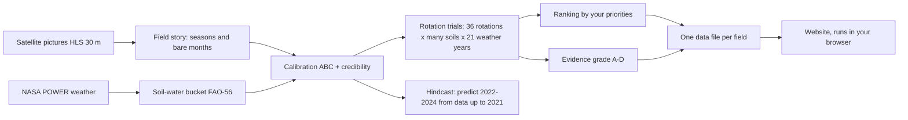
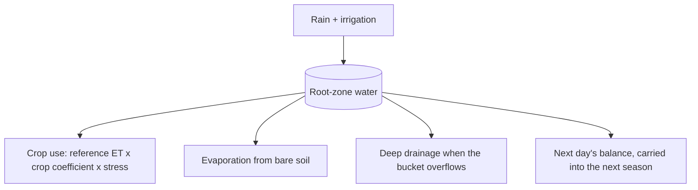
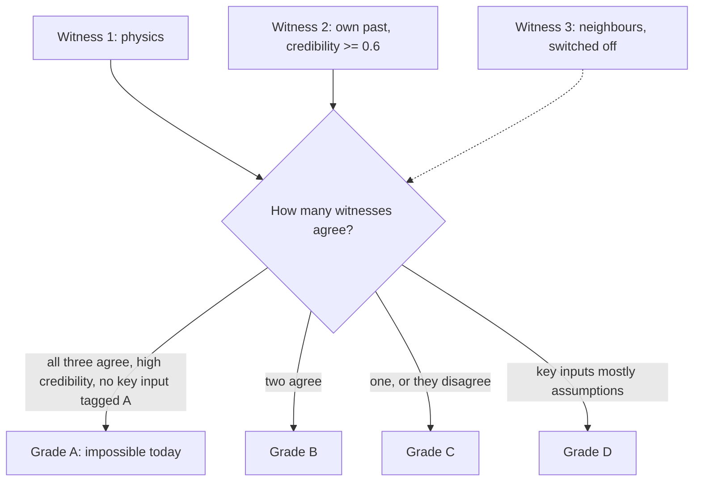

# How FieldWitness was built, and how its prediction works

*Plain-language guide for readers who do not write code. Written 12 Nov 2026 from the project's own records: the git history, `PLAN.md`, `DECISIONS.md`, `results/`, `config/`, `src/` and `app/`. Where the records are silent, the text says "The records don't say". An Arabic version is in [HOW_WE_BUILT_FIELDWITNESS.ar.md](HOW_WE_BUILT_FIELDWITNESS.ar.md). A longer account of the build, with more detail per stage, is in [HOW_WE_BUILT_FIELDWITNESS.md](HOW_WE_BUILT_FIELDWITNESS.md).*

FieldWitness is a free website for 200 real crop fields in Kansas, USA. For each field it lists possible three-season crop rotations (for example winter wheat, then sorghum, then a fallow season), ranks them, and shows how strong the evidence for each one is with a grade from A to D. It never tells anyone what to plant. It was built for the NASA Space Apps Challenge 2026, challenge "Field Shift".

**Who did the work.** The project owner (the user) set the goals, chose regions and scope, approved every new software package, data download over 1 GB and data-layout change, and reviewed each checkpoint. Two AI coding assistants wrote most of the code and documents under that direction: Claude Code (Anthropic) and, from 8 Nov 2026, Google Antigravity (Google). `PLAN.md` refers to earlier "planning research", which the brief for this document credits to a chat assistant. The records don't say which tool did it or which parts of the plan came from it. The website itself contains no AI: its ranking comes from formulas and its sentences from fixed templates.

**How to read the source tags.** Every number on the website carries one letter: **O** observed by satellite, **D** derived by a model from satellite data, **E** external non-NASA data, **A** an assumption made by the team.

- [Part A: how it was built, stage by stage](#part-a-how-it-was-built-stage-by-stage)
- [Part B: how the algorithm and prediction work](#part-b-how-the-algorithm-and-prediction-work)

---

## Part A: how it was built, stage by stage

The order below follows the git history (4 to 12 Nov 2026). Stages overlap in time, because several things were built at once. Each stage gives the dates, the goal, the steps, the reason, an everyday comparison, the results, what went wrong, and where to look.

| Stage | Dates (2026) | Key result |
|---|---|---|
| 0 Challenge and idea | 4 Nov (earlier work not recorded) | Plan with gates; three-witness idea |
| 1 Project set-up | 4 Nov | Checks and secret scan pass on GitHub |
| 2 Data access | 4 Nov | Each source tested with one real call |
| 3 Region and crops | 4 Nov | Kansas chosen by measurement; 11 crops from FAO-56 |
| 4 Fields and histories | 4 to 5 Nov | 200 fields; 134,685 field-dates; 1,600 labelled field-years |
| 5 Field story | 4 Nov | Season detection 78.3% against a 90% target (missed) |
| 6 Soil-water bucket | 4 Nov | Reproduces the FAO-56 worked example |
| 7 Calibration | 7 Nov | 185 of 200 fields get a credibility score |
| 8 Rotation engine | 7 to 8 Nov | 36 ranked rotations per field; grades B, C, D only |
| 9 Neighbour witness | 7 to 8 Nov | 0 of 92 passed; switched off |
| 10 Field packs | 4 and 7 Nov | 200 packs validate with no problems |
| 11 Website | 4 to 7 Nov | Five core views on real data |
| 12 Hindcast | 7 to 8 Nov | Small edge on 3 of 4 measures; ranges too narrow |
| 13 Online | 7 to 9 Nov | Live on GitHub Pages |
| 14 Second computer and AI | 8 Nov | All tests pass on the second laptop |
| 15 Polish | 8 Nov | Basemap, names, legend, light and dark |
| 16 Speed | 8 to 9 Nov | Starting code cut by 84.7% |
| 17 Late features and fixes | 9 to 12 Nov | 3D view, tour, builder, farm view; more honest negatives |

### Stage 0: Reading the challenge and choosing the idea
- **Dates:** 4 Nov. The records don't say when thinking began before that.
- **Goal:** turn the official challenge into a plan a small team and AI assistants could build in days.
- **Steps:** the challenge text went into `docs/official_challenge.md`; `PLAN.md` set phases that each end in a pass-or-fail "gate"; Claude Code reviewed it (version 1.1); version 1.2 matched it line by line to the challenge (current rotation as option 1, five-part explanations, calendars, weather sliders); a "never claim" list was fixed (no tonnes, no fertility from space, no prices or profit, no AI deciding).
- **Why:** build "the smallest demo that is still the real idea" first, end to end.
- **Analogy:** reading the exam question twice and writing an outline before the essay.
- **Results:** a phased plan with gates and fixed rules.
- **What went wrong:** the plan cited a 2025 paper as confirmed; Claude Code marked it unverified until it was checked (Stage 9). The records don't say who wrote version 1.0 or why this idea won.
- **Where to look:** `PLAN.md`, `docs/official_challenge.md`, `DECISIONS.md` ("Plan review").

### Stage 1: Setting up the workshop
- **Dates:** 4 Nov.
- **Goal:** a clean repository, automatic checks, a secret scanner and written rules before any science.
- **Steps:** Claude Code created the layout (commit 1d3a3a5) and pinned Python 3.12; GitHub runs the tests and the gitleaks secret scan on every change; `CLAUDE.md` holds twelve hard rules (never invent data or citations; test every outside service first; tag every number; report failures; ask before downloads over 1 GB, new packages or data-layout changes).
- **Why:** AI assistants can write convincing but invented details; the rules limit the damage.
- **Analogy:** setting up a lab with safety rules and a lab book before the first experiment.
- **Results:** the first change passed both checks; every later decision went into the dated log `DECISIONS.md`.
- **What went wrong:** two tool installs hung on Windows; a formatter damaged the plan's Markdown and was told to skip it; an early check used a token from the computer's credential manager, which led to rule 12 (never extract tokens or passwords).
- **Where to look:** `CLAUDE.md`, `DECISIONS.md` ("T0.1", "T0.2"), commits 1d3a3a5, 799f04a.

### Stage 2: Getting access to the data
- **Dates:** 4 Nov.
- **Goal:** prove with one small real request that each data source works.
- **Steps:** NASA login and an HLS search for the Kansas tile; an AppEEARS test (about 22.5 minutes, 17 files, checksums verified); boundary reads (20,190 CSB polygons in the Kansas box); NASA POWER weather worked; SoilGrids was down at first; the Kansas water-use records needed a disclaimer that only the user could accept.
- **Why:** rule 2, test before use. The user split sources into "essential" and "validation only", so a missing validation source would not block the project.
- **Analogy:** checking every road and bridge on the route before the trip.
- **Results:** satellite, weather, boundary and label sources confirmed; real response shapes recorded in `docs/api_notes.md`.
- **What went wrong:** the office network blocked one add-on, and the user chose not to work around it; a second AppEEARS login cancelled the first; two unverified soil sources were dropped.
- **Where to look:** `docs/api_notes.md`, `DATA.md`, `DECISIONS.md`.

### Stage 3: Choosing the region, and crop settings from FAO-56
- **Dates:** 4 Nov.
- **Goal:** pick regions by measurement and load crop water settings from the published guide.
- **Steps:** a census of six candidate areas (Kansas, Beauce, Toulouse, central Ukraine, Nile Delta, Punjab); the user set the measurability rule (at least four whole 30 m pixels, 15 m from the edge, which lifted Kansas from 88.6% to 98.1% measurable); the user chose Kansas first; `config/crops.yaml` got 11 crops, 82 values from FAO-56 tables and 9 team assumptions.
- **Why:** numbers make the choice traceable; rule 8 forbids constants from memory.
- **Analogy:** surveying several plots before buying one, and copying the building code from the official book.
- **Results:** three tiers on paper; only Kansas was carried through to the website.
- **What went wrong:** a crop-filter prefix wrongly dropped crops such as safflower, caught against the official table; many scenes cover only part of a tile.
- **Where to look:** `docs/census/`, `config/regions.yaml`, `config/crops.yaml`.

### Stage 4: Fields and their histories
- **Dates:** 4 to 5 Nov.
- **Goal:** pick 200 Kansas fields and collect each one's satellite, label, weather and soil history.
- **Steps:** 200 of 9,905 candidate parcels were picked with a fixed random seed (89 winter wheat, 57 sorghum, 54 maize), spread over 116 of 121 ten-kilometre blocks; HLS greenness came via point requests (about 1.3 GB, a user-approved exception to the 1 GB rule); CSB labels 2017 to 2024; POWER weather 2001 to 2024 with no gaps; SoilGrids values; the "as_of" guard was built.
- **Why:** the guard keeps later forecast tests honest; coarse data stays background only.
- **Analogy:** collecting 200 patients' records under one rule about which records the doctor may see.
- **Results:** 134,685 field-dates; all 1,600 field-years labelled; Gate 1 passed for Kansas.
- **What went wrong:** a shared login token caused a "forbidden" error; CSB field ids do not carry across years; the Kansas water-use records were never obtained.
- **Where to look:** `results/pilot_fields/`, `results/labels/`, `docs/gates/gate-1.md`.

### Stage 5: The field story
- **Dates:** 4 Nov.
- **Goal:** turn greenness curves into seasons and a bare-soil calendar (Part B4).
- **Steps:** smoothing (Savitzky–Golay), season and phase detection, a monthly bare-soil calendar (cut-off 0.30, tag A), a test with a pass mark fixed in advance (90%).
- **Why:** the calendar answers a challenge question directly; the fixed pass mark stops bending the result.
- **Analogy:** marking each heartbeat on a trace, then checking the marks against a doctor's.
- **Results:** 74.6% on the first 30 fields, 82.9% on a development set, **78.3%** on the fresh test set (155 of 198).
- **What went wrong:** the target was missed; the user decided not to tune further. A planned crop classifier was postponed.
- **Where to look:** `results/story/`, `DECISIONS.md` ("T2.2").

### Stage 6: The soil-water bucket
- **Dates:** 4 Nov.
- **Goal:** witness 1, a daily water ledger for each crop and rotation (Part B5).
- **Steps:** FAO-56 Penman–Monteith reference ET from POWER weather; crop coefficient curves; the daily balance (FAO-56 Eq. 82 to 85) with water stress; season outputs; rotation runs that carry soil water across seasons; a vulnerability calendar.
- **Why:** a public, standard method, so each number traces to a published equation.
- **Analogy:** a bank account: rain is a deposit, plants and sun are withdrawals.
- **Results:** tests reproduce the FAO-56 worked example; 200 fields × 30 parameter sets × 20 weather years took 8.4 seconds.
- **What went wrong:** the assistant first stopped because it could not open the FAO-56 text (rule 8); several settings are assumptions; the later soil check found the water capacity too low.
- **Where to look:** `src/fieldwitness/physics/`, `docs/fao56_equations.md`.

### Stage 7: Calibration
- **Dates:** 7 Nov.
- **Goal:** witness 2, tune five unknown settings per field to its own past and score the fit (Part B6).
- **Steps:** prior ranges with reasons (tag A); made-up test fields with known answers; ABC; checks on 300 and then 500 made-up fields; credibility scores on real fields.
- **Why:** ABC needs no assumption about the shape of errors, and made-up fields show what can be recovered.
- **Analogy:** tuning a guitar string against a reference note.
- **Results:** 185 of 200 fields scored; median 0.5; 42.7% at 0.6 or more.
- **What went wrong:** some settings were recovered with little information; "irrigated or not" was right 77% of the time; scores are in-sample; the irrigation check against water-use records was never done.
- **Where to look:** `results/inference/`, `config/priors.yaml`, `src/fieldwitness/infer/`.

### Stage 8: The rotation engine
- **Dates:** 7 to 8 Nov.
- **Goal:** list, simulate, rank, grade and explain every allowed rotation (Parts B7 to B9).
- **Steps:** Current first; 61 sequences filtered to 36 by rules; simulation over possible worlds and weather years 2001 to 2021; the user chose the RYI definition per rotation year; dominated options removed, then a weighted score; grades; "what to measure next"; template explanations; 12 weather what-ifs per field; farmer corrections kept in the browser.
- **Why:** the challenge asks for at least three strategies including the existing one, each explained.
- **Analogy:** a hiring panel that shows its scoring sheet and lets you change the weights.
- **Results:** 2,772 B, 3,600 C, 360 D, 0 A across 187 fields; the top option changes in 10% to 59.5% of fields under the what-ifs.
- **What went wrong:** early rankings rewarded bare fallow (fixed with bare-soil penalties and diversity rules); a rank-storage bug (Stage 10); what-if counts were first taken from intermediate output.
- **Where to look:** `src/fieldwitness/rotate/`, `config/ranking.yaml`, `config/grading.yaml`, `results/rotate/`.

### Stage 9: The neighbour witness (switched off)
- **Dates:** 7 to 8 Nov.
- **Goal:** witness 3, learn previous-crop effects from similar neighbouring fields.
- **Steps:** a 1,400-row table; two packages approved by the user (scikit-learn, doubleml); double machine learning with 10 km blocks held out together; four checks fixed in advance; a descriptive literature sign check (2 agree, 1 disagrees, 13 inconclusive); a matched second design.
- **Why:** pass marks set before looking stop cherry-picking.
- **Analogy:** a pass mark written before the papers are marked.
- **Results:** 0 of 92 (first design) and 0 of 32 (matched design) passed all checks. The witness is off; grades stop at B.
- **What went wrong:** a negative result, stated as such; the unattended assistant loop kept re-running the blocked paper check.
- **Where to look:** `results/neighbours/`, `docs/gates/gate-5.md`.

### Stage 10: One data file per field
- **Dates:** 4 Nov (data shapes approved by the user) and 7 Nov (pack builder).
- **Goal:** give the website checked files so it runs without a server.
- **Steps:** schemas in Python; a pack builder (37 options per field: Current plus 36); a validator that rejects untagged numbers and files of 300 KB or more; website data types generated from the Python shapes.
- **Why:** small files load fast and work offline; tagging stops unlabelled values.
- **Analogy:** a standard patient form, and a clerk who rejects incomplete forms.
- **Results:** all 200 packs validate (Gate 6); the demo folder now holds 1,203 files.
- **What went wrong:** the first real load stored the sort position instead of the rank (fixed in commit ce69ebf).
- **Where to look:** `src/fieldwitness/schemas.py`, `src/fieldwitness/packs/`, `docs/gates/gate-6.md`.

### Stage 11: The website
- **Dates:** 4 to 7 Nov.
- **Goal:** build the screens while the data was still being made.
- **Steps:** a branch with clearly marked SYNTHETIC sample data and a build guard that refuses to publish it; the map, field story and Field Card; then the Advisor console, scoreboard, calendar, explainers, map layers and Methods page; on 7 Nov the switch to the real packs (the "Gate 6 merge").
- **Why:** parallel work saves time; the guard stops fake numbers being shown as real.
- **Analogy:** a shop display with props, and a sign saying so, while the stock arrives.
- **Results:** Map, Field story, Field Card, Advisor console and Scoreboard work for all 200 fields (React, Vite, TypeScript, MapLibre).
- **What went wrong:** the real-data load exposed the rank bug; package installs were blocked in unattended runs.
- **Where to look:** `app/src/`, `app/fixtures/`.

### Stage 12: Testing against the past
- **Dates:** 7 to 8 Nov.
- **Goal:** check whether the method forecasts better than simple methods (Part B10).
- **Steps:** cut-off 31 Dec 2021; stages 5 to 8 re-run on older data; 2022 to 2024 predicted; scored in forecast and forced modes; three baselines.
- **Why:** a method is trusted only if it beats a simple one on unseen data.
- **Analogy:** an exam on unseen questions, compared with last year's class average.
- **Results:** 266 maize and sorghum field-seasons on 7 Nov, 463 with winter wheat on 8 Nov; small edges, ranges too narrow.
- **What went wrong:** weak skill was found on the first run and kept as it was; winter wheat has no baseline.
- **Where to look:** `results/hindcast/`, `scripts/t73_baselines.py`.

### Stage 13: Going online
- **Dates:** 7 to 9 Nov.
- **Goal:** a public address with no login.
- **Steps:** a hosting comparison (first visit 7.7 MB compressed); a GitHub Pages workflow with the demo packs in the repository; the Netlify link removed so Pages is the one address; sturdier checks on 9 Nov.
- **Why:** static files need no server or database, and visitors' data stays on their device.
- **Analogy:** printing a booklet each reader takes home, instead of running a help desk.
- **Results:** live at https://amr-mousa-eg.github.io/fieldwitness/, working offline after the first visit.
- **What went wrong:** the records don't say who ran the first deployment or when the repository became public.
- **Where to look:** `app/deploy/README.md`, `.github/workflows/pages.yml`.

### Stage 14: A second computer and a second AI assistant
- **Dates:** 8 Nov.
- **Goal:** continue on a second laptop with Google Antigravity, losing nothing.
- **Steps:** a migration plan; a clean copy from GitHub plus about 1.57 GB of data carried separately; the environment rebuilt; everything re-checked; the unattended Claude Code loop paused.
- **Why:** a clean copy proves nothing depends on one machine's hidden state.
- **Analogy:** moving house and switching every light on to check.
- **Results:** 247 Python tests and 58 website tests passed; 0 pack problems. `AI_USE.md` credits Antigravity with the migration check, the second neighbour analyses and much of Phases 10 to 12.
- **What went wrong:** a stale blocking note had to be removed. The records don't say why the move was needed.
- **Where to look:** `docs/MIGRATION_PLAN.md`, `AI_USE.md`.

### Stage 15: Polish
- **Dates:** 8 Nov.
- **Goal:** make the site readable and trustworthy before the freeze.
- **Steps:** a NASA true-colour basemap with credit; names Field 1 to Field 200; a legend; light, dark and automatic modes; the weak results stated in the app; a first-visit guide.
- **Why:** limits belong on the page, not hidden in a file.
- **Analogy:** tidying and labelling a shop before opening day.
- **Results:** all P0 and P1 tasks done; keyboard check 13 of 13.
- **What went wrong:** a Nile Delta confidence map and the Toulouse region were dropped.
- **Where to look:** `PLAN.md` (Phase 11).

### Stage 16: Speed
- **Dates:** 8 to 9 Nov.
- **Goal:** find why the site was slow, fix the causes, measure again.
- **Steps:** lazy loading cut the starting bundle from 1,785.76 KB to 273.64 KB (84.7%); first-load requests fell from 838 to 38; layout jumps removed; on 9 Nov new features dropped the desktop score from 88 to 31, and moving code into later-loaded pieces fixed it.
- **Why:** farmers may have slow phones and networks.
- **Analogy:** packing for day one and mailing the rest.
- **Results:** a much smaller starting load; a mobile score of 66 to 67 accepted as it was.
- **What went wrong:** the 9 Nov slowdown came from the team's own new features and was caught by measuring.
- **Where to look:** `DECISIONS.md` ("P1.13", "P1.14").

### Stage 17: Late features, checks and fixes
- **Dates:** 9 to 12 Nov.
- **Goal:** make the evidence clearer and the site easier to try, without changing any result.
- **Steps:** Add my field; the plain-language summary; the 3D view ("Illustration of simulated values — not a photo"); a "try it" tour; a pre-registered hindcast diagnosis and grade-validity test; "Why this ranking?" and "What we got wrong"; a read-only USDA SSURGO soil check; the Rotation Builder and farm view ("Scenery, not data"), on for everyone from 11 Nov with `?builder=0` and `?farm=0` as kill switches; a shared theme store that removed the 3D toggle lag. On 12 Nov: the first version of this account (PR #12), coordination rules for the two AI agents (PR #16), and three experiments kept as drafts and not adopted (PRs #13, #14, #15).
- **Why:** visitors learn most by trying; every feature kept the same honesty rules.
- **Analogy:** after building the engine, adding a dashboard so the driver can see what it does.
- **Results:** browser parity over 2,160 runs, largest difference 0.0000057 mm; 3D toggle on a simulated phone from 170–1,207 ms to 42–85 ms.
- **What went wrong:** the grade-validity test did not pass; the soil check was negative (142 mm against 282 mm); the tour button was invisible in light mode; pages scrolled sideways on phones; a hard-coded weather year contradicted the data. All were recorded; the fixable ones were fixed.
- **Where to look:** `PLAN.md` (Phase 12), `results/validation/`, `app/src/builder/`, `docs/COORDINATION.md`.

### What exists now
One region (Kansas tile T14SLH, 200 fields), a public website, and an open repository with the pipeline, tests, negative results and decision log. Building stopped at the end of 12 Nov 2026 (feature freeze). Work after that is fixes, documents and experiments that stay on their own branches.

---

## Part B: how the algorithm and prediction work

### B1. The whole pipeline in one picture

Text version:
1. Satellite pictures (HLS, 30 m pixels) show how green each field was, about every few days since 2015.
2. These curves become a "field story": when each season started, peaked and ended, and which months were bare.
3. NASA POWER daily weather drives a soil-water "bucket" that follows the FAO-56 guide.
4. Calibration tunes the bucket for each field until it imitates that field's own past seasons, and gives a credibility score.
5. Rotation trials simulate 36 possible three-season rotations under many soil settings and 21 past weather years (2001 to 2021).
6. Ranking orders the rotations by the priorities the visitor sets; grading says how strong the evidence is.
7. Everything for one field is packed into a small set of data files.
8. The website reads those files in the visitor's browser. No server does any thinking.
9. Separately, a hindcast tests the method on the past: it uses data only up to 31 Dec 2021 and predicts 2022 to 2024.

### B2. What is predicted, and what is not

**Predicted (for each field and each rotation):** crop water use (mm over three seasons), irrigation (mm), "bad-year water" (the average of the driest 10% of simulated years, called CVaR10), days with ground cover and the matching bare-soil months, and a Relative Yield Index (RYI) from 0 to 1. The RYI says how much water shortage held a crop back. It is not a harvest in tonnes.

**Checked against satellites (hindcast):** the green-up date, the peak date, the total greenness over the season (the "canopy integral"), and the number of ground-cover days.

**Never predicted:** yield in tonnes, soil fertility, prices, profit, or the weather of a future year. The weather what-ifs (hotter, drier) are tests on past weather, not climate forecasts.

### B3. The data ingredients

| Ingredient | What it gives | Tag | Used for |
|---|---|---|---|
| HLS (NASA, Landsat + Sentinel-2), 30 m | greenness (NDVI) of each field, 2015 to 2024 | O, and D once smoothed | the field story, calibration, the hindcast |
| NASA POWER daily weather (coarse grid) | rain, temperature, sun, wind, 2001 to 2024 | used as model forcing | the soil-water bucket |
| SoilGrids (coarser than a field) | soil properties | context only | regional context; not the bucket's water capacity (see FAQ 9) |
| SMAP soil moisture, GRACE water storage | regional signals | context only | map layers, never field claims |
| USDA Crop Sequence Boundaries (CSB) | field outlines and crop labels 2017 to 2024 | E | which crop grew where; the 200 pilot fields |
| FAO-56 guide | formulas and crop tables | cited source | the bucket's equations and crop settings |
| Team choices | thresholds, ranking weights, prior ranges | A | marked A wherever shown |

The scale rule: coarse data (weather, soil, regional water) is only background or forcing. Claims about a single field use the 30 m pixels, and only pixels fully inside the field (15 m from the edge, at least 4 pixels).

### B4. The field story: finding seasons, and the target it missed

The raw greenness points are smoothed (Savitzky–Golay filter) because clouds add noise. Code then finds each season's start, peak and end, and builds a bare-soil calendar: for each month, the share of past years in which the field was bare. "Bare" means greenness below 0.30, a team choice (A).

The season detector was tested against known crop labels with a pass mark fixed in advance: at least 90% of seasons right. It reached **78.3%** on a fresh test set (155 of 198 field-seasons). It **missed** the target. Winter wheat and fallow were the hardest. The team decided not to keep tuning, and the website says so. Because the planned crop classifier was postponed, the crop timing windows in the model are team choices, not detected values.

### B5. The soil-water bucket (FAO-56)

Text version:
1. Each day, rain and any irrigation are added to the water in the root zone.
2. The crop takes water: the reference evapotranspiration from the weather (FAO-56 Penman–Monteith), times a crop coefficient for its growth stage, times a stress factor that shrinks as the soil dries.
3. Bare soil also loses some water to evaporation.
4. If the bucket is over-full, the extra drains below the roots.
5. The balance carries over to the next day, and from one season into the next, so a thirsty crop leaves a drier soil for the crop after it.

The ledger follows FAO-56 equations 82 to 85. The tests reproduce the guide's own worked example, and property tests with many random inputs check that water is conserved every day.

**Toy example with round numbers.** Suppose the bucket can hold 100 mm that plants can use, and this morning it holds 60 mm. It rains 10 mm. The crop would use 6 mm on a well-watered day, and the soil is moist enough that there is no stress. Evening balance: 60 + 10 − 6 = 64 mm. Nothing drains, because 64 is below 100. If instead it had rained 50 mm, the balance would be 60 + 50 − 6 = 104 mm, so 4 mm would drain away and 100 mm would stay.

### B6. Calibration (ABC) and the credibility score

Five settings of each field are unknown: the sowing-date offset, a scale on the soil's water capacity, whether the field is irrigated, the seasonal irrigation amount, and a scale on the crop coefficient. Each has a starting range with a written reason (tag A, `config/priors.yaml`).

The method is **approximate Bayesian computation (ABC)**. It tries thousands of combinations, simulates each past season, compares it with the field's satellite curve, and keeps the closest ones (in the test, 300 out of 6,000 per year). The kept combinations are the field's "possible worlds".

Before using it on real fields, the method was tried on made-up fields with known answers: three settings were recovered with little new information, the sowing offset was over-cautious, and "irrigated or not" was right 77% of the time. These limits are reported.

The **credibility score** (0 to 1) measures how well the calibrated model reproduces the field's own past seasons: half from rank agreement of seasons, half from timing error (`config/grading.yaml`, both team choices). **185 of 200** fields get a score; the median is 0.5, and 42.7% score 0.6 or more. The other 15 grew only winter wheat, which is not calibrated. The score is in-sample: the same history is used to fit and to score.

### B7. Rotation trials and their metrics

The candidates come from five Kansas choices: maize, sorghum, winter wheat, fallow and a cover crop. Rules remove bad ones: the calendar must fit; at most two seasons in a row from the same plant family; at least one harvested crop; no two non-crop seasons in a row. Of 61 sequences first listed, **36** remain per field. The field's current rotation (its last three seasons) is always shown first as "Current".

Each rotation is simulated in every possible world of the field and with the weather of 2001 to 2021. The outputs listed in B2 are averaged; "bad-year" values use the worst 10% of years. Six more descriptive metrics are stored (for example nitrogen-fixing share, erosion exposure, a residue proxy).

### B8. Ranking

First, any rotation that is worse than another on every measure is removed. The rest get a weighted score. The default "balanced" weights (`config/ranking.yaml`, tag A) are: RYI 0.25, ground-cover days 0.20, bad-year RYI 0.15, water use 0.15, irrigation 0.15, bad-year water 0.10. On the website, the "What matters most to you?" sliders change the weights and re-rank at once in the browser. Constraints (crops you cannot grow or sell, a water cap) remove options; Current is always kept.

### B9. Evidence grades and the three witnesses

Text version:
1. Witness 1, physics: the bucket says how a rotation changes the RYI compared with Current, with a 90% range from weather variation.
2. Witness 2, the field's own past: it "agrees" when the credibility score is at least 0.6.
3. Witness 3, neighbours: natural experiments across similar fields. It is switched off.
4. Grade A needs physics and neighbours to agree, high credibility and no key input tagged A. Without neighbours, A cannot happen.
5. Grade B: two witnesses agree. Grade C: one witness, or they disagree. Grade D: more than half of the decision-driving inputs are assumptions.

**Why the neighbour witness is off.** The method was double machine learning on 1,400 field-seasons, with four pass-or-fail checks fixed in advance (overlap, balance, placebo, negative control). In the first design, **0 of 92** fitted estimates passed all four checks; balance failed in every one. In the matched design, **0 of 32** passed all checks. So the witness stays off, and the best possible grade is B.

Across 187 graded fields with 36 options each: **2,772 B, 3,600 C, 360 D, 0 A**. Thirteen fields have no grades because their current rotation could not be simulated.

### B10. The hindcast: testing on the past

The "as_of" guard lets code read only data dated on or before a cut-off. With the cut-off at 31 Dec 2021, the whole method was re-run and "predicted" 2022, 2023 and 2024. Tests check that no data reader can pass the cut-off. Two modes: **forecast** (past weather only, as a real forecast would be) and **forced** (the weather that really happened).

The results were compared with three simple **baselines**: B0, the field's own earlier seasons of the same crop; B1, the FAO table method with default dates and soil; B2, the same physics without calibration. (B3, neighbours only, was never run.)

On 266 maize and sorghum field-seasons (lower is better; the last column is how often the 90% range held the truth, which should be about 90%):

| Measure | FieldWitness | Best baseline | 90% range held the truth |
|---|---|---|---|
| Green-up date | 19.3 | 20.7 (B0) | 52% |
| Peak date | 11.5 | 12.7 (B2) | 89% |
| Season greenness total | 14.9 | 15.1 (B0) | 35% |
| Ground-cover days | 30.4 | 25.3 (B0 is better) | 9% |

In plain words: FieldWitness is ahead on three of four measures by small margins, behind on ground-cover days, and its ranges are too narrow. Across fields, the field's own past average (B0) ordered the fields better (rank correlation 0.33 against 0.26).

A later pre-registered breakdown (`results/hindcast/diagnosis.md`, 463 field-seasons including winter wheat, spatial block bootstrap) found: overall CRPS 14.86 against 16.10 for B1 and 16.22 for B2 (both differences above zero, so FieldWitness is better); better for maize; for sorghum the interval includes zero (not shown to be better); winter wheat has no baseline and a peak-timing error of 58.9 days on average.

**Do the grades predict accuracy?** A test fixed in advance compared grade B with grade D: CRPS 16.96 against 24.02, difference 7.07, 95% interval −3.28 to 14.32. The interval includes zero, so the test **did not pass**. Grade D had only 25 field-seasons.

### B11. Browser-port parity

The Rotation Builder re-runs the bucket inside the browser (TypeScript), so the visitor can grow a rotation. To check that the browser copy matches the Python original, 20 fields × 36 rotations × 3 weather cases = **2,160 runs** were compared. The largest difference was **0.0000057 mm**, against a pass limit of 0.05 mm.

### B12. Uncertainty, and why predictions can be wrong

- **Weather:** a season's real weather is unknown in advance. Forecast mode uses past weather, so a hot or dry year surprises it.
- **Soil:** an independent check with the USDA SSURGO soil survey found the model's soil water capacity far below the survey (median 142 mm against 282 mm) and no field-to-field correlation (Pearson −0.09). This is a known weakness.
- **Season timing:** the detector is right 78.3% of the time, and winter wheat timing is poorly modelled.
- **Ranges too narrow:** the 90% ranges held the truth far less often than 90% (table above), so the stated uncertainty is too small.
- **Fragile ranking:** under the weather what-ifs the top option changes in 10% to 59.5% of fields.
- **Assumptions:** default weights, thresholds and prior ranges are team choices (A).

An experiment after the build (draft PR #14, not adopted) tried to widen the ranges with conformal recalibration; it failed its own pre-set gate. The records don't say yet why the 2022–2024 errors are biased; a separate experiment is planned for that.

### B13. A worked example with a real field: Field 1

Field 1 (id starting `02cced77`) has an area of 53.564 ha and 542 interior satellite pixels; its boundary comes from CSB, and its data runs to 31 Dec 2024. Its crop labels in the story are: winter wheat 2017, maize 2018, maize 2019, maize 2021, winter wheat 2024. Its credibility score is **0.637 (D)**.

| Option | Sequence | Water use (D) | Bad-year water (D) | RYI (D) | Ground-cover days (D) | Grade |
|---|---|---|---|---|---|---|
| Current | maize → fallow → winter wheat | 1,500 mm | 1,772 mm | 0.26 | 260 | reference, not graded |
| Rank 1 | winter wheat → sorghum → fallow | 1,451 mm | 1,702 mm | 0.35 | 243 | B |
| Rank 2 | sorghum → sorghum → fallow | 1,413 mm | 1,668 mm | 0.40 | 190 | B |

(Values rounded from the field pack. All values are per three-season rotation; RYI is per rotation year.)

Why rank 1 gets B: the pack gives the reasons "own past agrees (credibility 0.64 >= 0.6)" and "no neighbour estimate". The Advisor console says: "Measure the soil water holding capacity (TAW): it changes rank 1 in 30% of worlds." Rank 1 also changes if the soil water capacity is 30% lower, if the crop water-use scale is 20% lower, or if seasonal irrigation is 50 mm higher.

### B14. Honest answers to common questions

1. **Does it tell me what to plant?** No. It ranks options, shows the evidence, and grades it. The decision stays with the farmer.
2. **Does it predict my harvest?** No. The RYI (0 to 1) shows water limitation only, never tonnes, prices or profit.
3. **How accurate is it?** Mixed. It beats simple methods on three of four measures by small margins, is worse on ground-cover days, and its uncertainty ranges are too narrow.
4. **Why is there no grade A?** Grade A needs the neighbour witness, which failed its own checks (0 of 92, and 0 of 32 in the matched design).
5. **Do grades mean my forecast will be more accurate?** We could not show that; the test did not pass.
6. **Why did the season detector miss its target?** The records show winter wheat and fallow were the hardest; the team stopped tuning at 78.3% to avoid fitting to the test.
7. **Can it see the future weather?** No. Forecast mode uses past weather; the what-ifs are sensitivity tests, not climate projections.
8. **Could the hindcast have cheated by seeing later data?** A guard blocks reading any data after the cut-off, and tests check every reader. Field boundaries come from recent map editions (geometry only); this exception is recorded.
9. **Is the soil data right?** Not for water capacity: the independent soil survey disagrees strongly (142 mm against 282 mm median).
10. **Does it work outside Kansas?** Not yet. Only one satellite tile (T14SLH) is analysed; France and Ukraine are planned only.
11. **Is an AI deciding?** No. Formulas rank, templates explain. AI assistants helped write the code.
12. **What happens to my data?** There is no server. What you type stays in your browser.
