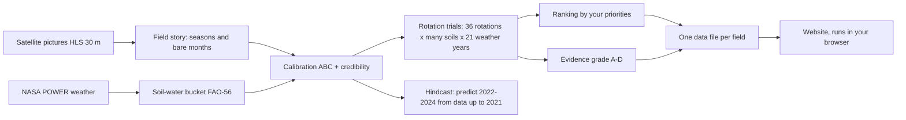
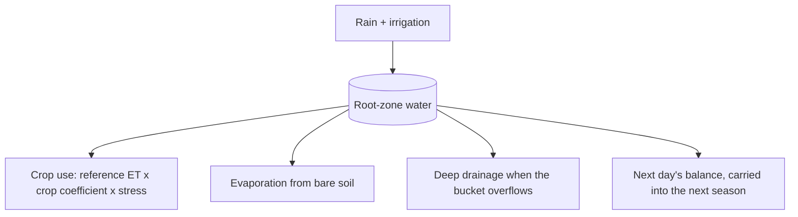
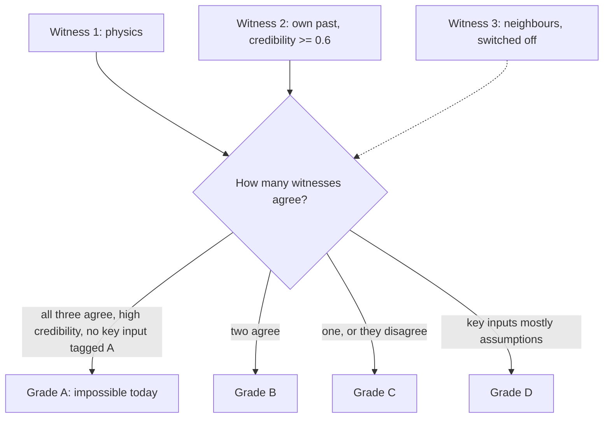

# How FieldWitness was built, and how its prediction works

*Plain-language guide for readers who do not write code. Written 12 Nov 2026 from the project's own records: the git history, `PLAN.md`, `DECISIONS.md`, `results/`, `config/`, `src/` and `app/`. Where the records are silent, the text says "The records don't say". An Arabic version is in [HOW_WE_BUILT_FIELDWITNESS.ar.md](HOW_WE_BUILT_FIELDWITNESS.ar.md). A longer account of the build, with more detail per stage, is in [HOW_WE_BUILT_FIELDWITNESS.md](HOW_WE_BUILT_FIELDWITNESS.md).*

FieldWitness is a free website for 200 real crop fields in Kansas, USA. For each field it lists possible three-season crop rotations (for example winter wheat, then sorghum, then a fallow season), ranks them, and shows how strong the evidence for each one is with a grade from A to D. It never tells anyone what to plant. It was built for the NASA Space Apps Challenge 2026, challenge "Field Shift".

**Who did the work.** The project owner (the user) set the goals, chose regions and scope, approved every new software package, data download over 1 GB and data-layout change, and reviewed each checkpoint. Two AI coding assistants wrote most of the code and documents under that direction: Claude Code (Anthropic) and, from 8 Nov 2026, Google Antigravity (Google). `PLAN.md` refers to earlier "planning research", which the brief for this document credits to a chat assistant. The records don't say which tool did it or which parts of the plan came from it. The website itself contains no AI: its ranking comes from formulas and its sentences from fixed templates.

**How to read the source tags.** Every number on the website carries one letter: **O** observed by satellite, **D** derived by a model from satellite data, **E** external non-NASA data, **A** an assumption made by the team.

- [Part A: how it was built, stage by stage](#part-a-how-it-was-built-stage-by-stage)
- [Part B: how the algorithm and prediction work](#part-b-how-the-algorithm-and-prediction-work)

---

## Part A: how it was built, stage by stage

*(Part A follows Part B in the writing order of this document; see below.)*

PART_A_PLACEHOLDER

---

## Part B: how the algorithm and prediction work

### B1. The whole pipeline in one picture

Text version:
1. Satellite pictures (HLS, 30 m pixels) show how green each field was, about every few days since 2015.
2. These curves become a "field story": when each season started, peaked and ended, and which months were bare.
3. NASA POWER daily weather drives a soil-water "bucket" that follows the FAO-56 guide.
4. Calibration tunes the bucket for each field until it imitates that field's own past seasons, and gives a credibility score.
5. Rotation trials simulate 36 possible three-season rotations under many soil settings and 21 past weather years (2001 to 2021).
6. Ranking orders the rotations by the priorities the visitor sets; grading says how strong the evidence is.
7. Everything for one field is packed into a small set of data files.
8. The website reads those files in the visitor's browser. No server does any thinking.
9. Separately, a hindcast tests the method on the past: it uses data only up to 31 Dec 2021 and predicts 2022 to 2024.

### B2. What is predicted, and what is not

**Predicted (for each field and each rotation):** crop water use (mm over three seasons), irrigation (mm), "bad-year water" (the average of the driest 10% of simulated years, called CVaR10), days with ground cover and the matching bare-soil months, and a Relative Yield Index (RYI) from 0 to 1. The RYI says how much water shortage held a crop back. It is not a harvest in tonnes.

**Checked against satellites (hindcast):** the green-up date, the peak date, the total greenness over the season (the "canopy integral"), and the number of ground-cover days.

**Never predicted:** yield in tonnes, soil fertility, prices, profit, or the weather of a future year. The weather what-ifs (hotter, drier) are tests on past weather, not climate forecasts.

### B3. The data ingredients

| Ingredient | What it gives | Tag | Used for |
|---|---|---|---|
| HLS (NASA, Landsat + Sentinel-2), 30 m | greenness (NDVI) of each field, 2015 to 2024 | O, and D once smoothed | the field story, calibration, the hindcast |
| NASA POWER daily weather (coarse grid) | rain, temperature, sun, wind, 2001 to 2024 | used as model forcing | the soil-water bucket |
| SoilGrids (coarser than a field) | soil properties | context only | regional context; not the bucket's water capacity (see FAQ 9) |
| SMAP soil moisture, GRACE water storage | regional signals | context only | map layers, never field claims |
| USDA Crop Sequence Boundaries (CSB) | field outlines and crop labels 2017 to 2024 | E | which crop grew where; the 200 pilot fields |
| FAO-56 guide | formulas and crop tables | cited source | the bucket's equations and crop settings |
| Team choices | thresholds, ranking weights, prior ranges | A | marked A wherever shown |

The scale rule: coarse data (weather, soil, regional water) is only background or forcing. Claims about a single field use the 30 m pixels, and only pixels fully inside the field (15 m from the edge, at least 4 pixels).

### B4. The field story: finding seasons, and the target it missed

The raw greenness points are smoothed (Savitzky–Golay filter) because clouds add noise. Code then finds each season's start, peak and end, and builds a bare-soil calendar: for each month, the share of past years in which the field was bare. "Bare" means greenness below 0.30, a team choice (A).

The season detector was tested against known crop labels with a pass mark fixed in advance: at least 90% of seasons right. It reached **78.3%** on a fresh test set (155 of 198 field-seasons). It **missed** the target. Winter wheat and fallow were the hardest. The team decided not to keep tuning, and the website says so. Because the planned crop classifier was postponed, the crop timing windows in the model are team choices, not detected values.

### B5. The soil-water bucket (FAO-56)

Text version:
1. Each day, rain and any irrigation are added to the water in the root zone.
2. The crop takes water: the reference evapotranspiration from the weather (FAO-56 Penman–Monteith), times a crop coefficient for its growth stage, times a stress factor that shrinks as the soil dries.
3. Bare soil also loses some water to evaporation.
4. If the bucket is over-full, the extra drains below the roots.
5. The balance carries over to the next day, and from one season into the next, so a thirsty crop leaves a drier soil for the crop after it.

The ledger follows FAO-56 equations 82 to 85. The tests reproduce the guide's own worked example, and property tests with many random inputs check that water is conserved every day.

**Toy example with round numbers.** Suppose the bucket can hold 100 mm that plants can use, and this morning it holds 60 mm. It rains 10 mm. The crop would use 6 mm on a well-watered day, and the soil is moist enough that there is no stress. Evening balance: 60 + 10 − 6 = 64 mm. Nothing drains, because 64 is below 100. If instead it had rained 50 mm, the balance would be 60 + 50 − 6 = 104 mm, so 4 mm would drain away and 100 mm would stay.

### B6. Calibration (ABC) and the credibility score

Five settings of each field are unknown: the sowing-date offset, a scale on the soil's water capacity, whether the field is irrigated, the seasonal irrigation amount, and a scale on the crop coefficient. Each has a starting range with a written reason (tag A, `config/priors.yaml`).

The method is **approximate Bayesian computation (ABC)**. It tries thousands of combinations, simulates each past season, compares it with the field's satellite curve, and keeps the closest ones (in the test, 300 out of 6,000 per year). The kept combinations are the field's "possible worlds".

Before using it on real fields, the method was tried on made-up fields with known answers: three settings were recovered with little new information, the sowing offset was over-cautious, and "irrigated or not" was right 77% of the time. These limits are reported.

The **credibility score** (0 to 1) measures how well the calibrated model reproduces the field's own past seasons: half from rank agreement of seasons, half from timing error (`config/grading.yaml`, both team choices). **185 of 200** fields get a score; the median is 0.5, and 42.7% score 0.6 or more. The other 15 grew only winter wheat, which is not calibrated. The score is in-sample: the same history is used to fit and to score.

### B7. Rotation trials and their metrics

The candidates come from five Kansas choices: maize, sorghum, winter wheat, fallow and a cover crop. Rules remove bad ones: the calendar must fit; at most two seasons in a row from the same plant family; at least one harvested crop; no two non-crop seasons in a row. Of 61 sequences first listed, **36** remain per field. The field's current rotation (its last three seasons) is always shown first as "Current".

Each rotation is simulated in every possible world of the field and with the weather of 2001 to 2021. The outputs listed in B2 are averaged; "bad-year" values use the worst 10% of years. Six more descriptive metrics are stored (for example nitrogen-fixing share, erosion exposure, a residue proxy).

### B8. Ranking

First, any rotation that is worse than another on every measure is removed. The rest get a weighted score. The default "balanced" weights (`config/ranking.yaml`, tag A) are: RYI 0.25, ground-cover days 0.20, bad-year RYI 0.15, water use 0.15, irrigation 0.15, bad-year water 0.10. On the website, the "What matters most to you?" sliders change the weights and re-rank at once in the browser. Constraints (crops you cannot grow or sell, a water cap) remove options; Current is always kept.

### B9. Evidence grades and the three witnesses

Text version:
1. Witness 1, physics: the bucket says how a rotation changes the RYI compared with Current, with a 90% range from weather variation.
2. Witness 2, the field's own past: it "agrees" when the credibility score is at least 0.6.
3. Witness 3, neighbours: natural experiments across similar fields. It is switched off.
4. Grade A needs physics and neighbours to agree, high credibility and no key input tagged A. Without neighbours, A cannot happen.
5. Grade B: two witnesses agree. Grade C: one witness, or they disagree. Grade D: more than half of the decision-driving inputs are assumptions.

**Why the neighbour witness is off.** The method was double machine learning on 1,400 field-seasons, with four pass-or-fail checks fixed in advance (overlap, balance, placebo, negative control). In the first design, **0 of 92** fitted estimates passed all four checks; balance failed in every one. In the matched design, **0 of 32** passed all checks. So the witness stays off, and the best possible grade is B.

Across 187 graded fields with 36 options each: **2,772 B, 3,600 C, 360 D, 0 A**. Thirteen fields have no grades because their current rotation could not be simulated.

### B10. The hindcast: testing on the past

The "as_of" guard lets code read only data dated on or before a cut-off. With the cut-off at 31 Dec 2021, the whole method was re-run and "predicted" 2022, 2023 and 2024. Tests check that no data reader can pass the cut-off. Two modes: **forecast** (past weather only, as a real forecast would be) and **forced** (the weather that really happened).

The results were compared with three simple **baselines**: B0, the field's own earlier seasons of the same crop; B1, the FAO table method with default dates and soil; B2, the same physics without calibration. (B3, neighbours only, was never run.)

On 266 maize and sorghum field-seasons (lower is better; the last column is how often the 90% range held the truth, which should be about 90%):

| Measure | FieldWitness | Best baseline | 90% range held the truth |
|---|---|---|---|
| Green-up date | 19.3 | 20.7 (B0) | 52% |
| Peak date | 11.5 | 12.7 (B2) | 89% |
| Season greenness total | 14.9 | 15.1 (B0) | 35% |
| Ground-cover days | 30.4 | 25.3 (B0 is better) | 9% |

In plain words: FieldWitness is ahead on three of four measures by small margins, behind on ground-cover days, and its ranges are too narrow. Across fields, the field's own past average (B0) ordered the fields better (rank correlation 0.33 against 0.26).

A later pre-registered breakdown (`results/hindcast/diagnosis.md`, 463 field-seasons including winter wheat, spatial block bootstrap) found: overall CRPS 14.86 against 16.10 for B1 and 16.22 for B2 (both differences above zero, so FieldWitness is better); better for maize; for sorghum the interval includes zero (not shown to be better); winter wheat has no baseline and a peak-timing error of 58.9 days on average.

**Do the grades predict accuracy?** A test fixed in advance compared grade B with grade D: CRPS 16.96 against 24.02, difference 7.07, 95% interval −3.28 to 14.32. The interval includes zero, so the test **did not pass**. Grade D had only 25 field-seasons.

### B11. Browser-port parity

The Rotation Builder re-runs the bucket inside the browser (TypeScript), so the visitor can grow a rotation. To check that the browser copy matches the Python original, 20 fields × 36 rotations × 3 weather cases = **2,160 runs** were compared. The largest difference was **0.0000057 mm**, against a pass limit of 0.05 mm.

### B12. Uncertainty, and why predictions can be wrong

- **Weather:** a season's real weather is unknown in advance. Forecast mode uses past weather, so a hot or dry year surprises it.
- **Soil:** an independent check with the USDA SSURGO soil survey found the model's soil water capacity far below the survey (median 142 mm against 282 mm) and no field-to-field correlation (Pearson −0.09). This is a known weakness.
- **Season timing:** the detector is right 78.3% of the time, and winter wheat timing is poorly modelled.
- **Ranges too narrow:** the 90% ranges held the truth far less often than 90% (table above), so the stated uncertainty is too small.
- **Fragile ranking:** under the weather what-ifs the top option changes in 10% to 59.5% of fields.
- **Assumptions:** default weights, thresholds and prior ranges are team choices (A).

An experiment after the build (draft PR #14, not adopted) tried to widen the ranges with conformal recalibration; it failed its own pre-set gate. The records don't say yet why the 2022–2024 errors are biased; a separate experiment is planned for that.

### B13. A worked example with a real field: Field 1

Field 1 (id starting `02cced77`) has an area of 53.564 ha and 542 interior satellite pixels; its boundary comes from CSB, and its data runs to 31 Dec 2024. Its crop labels in the story are: winter wheat 2017, maize 2018, maize 2019, maize 2021, winter wheat 2024. Its credibility score is **0.637 (D)**.

| Option | Sequence | Water use (D) | Bad-year water (D) | RYI (D) | Ground-cover days (D) | Grade |
|---|---|---|---|---|---|---|
| Current | maize → fallow → winter wheat | 1,500 mm | 1,772 mm | 0.26 | 260 | reference, not graded |
| Rank 1 | winter wheat → sorghum → fallow | 1,451 mm | 1,702 mm | 0.35 | 243 | B |
| Rank 2 | sorghum → sorghum → fallow | 1,413 mm | 1,668 mm | 0.40 | 190 | B |

(Values rounded from the field pack. All values are per three-season rotation; RYI is per rotation year.)

Why rank 1 gets B: the pack gives the reasons "own past agrees (credibility 0.64 >= 0.6)" and "no neighbour estimate". The Advisor console says: "Measure the soil water holding capacity (TAW): it changes rank 1 in 30% of worlds." Rank 1 also changes if the soil water capacity is 30% lower, if the crop water-use scale is 20% lower, or if seasonal irrigation is 50 mm higher.

### B14. Honest answers to common questions

1. **Does it tell me what to plant?** No. It ranks options, shows the evidence, and grades it. The decision stays with the farmer.
2. **Does it predict my harvest?** No. The RYI (0 to 1) shows water limitation only, never tonnes, prices or profit.
3. **How accurate is it?** Mixed. It beats simple methods on three of four measures by small margins, is worse on ground-cover days, and its uncertainty ranges are too narrow.
4. **Why is there no grade A?** Grade A needs the neighbour witness, which failed its own checks (0 of 92, and 0 of 32 in the matched design).
5. **Do grades mean my forecast will be more accurate?** We could not show that; the test did not pass.
6. **Why did the season detector miss its target?** The records show winter wheat and fallow were the hardest; the team stopped tuning at 78.3% to avoid fitting to the test.
7. **Can it see the future weather?** No. Forecast mode uses past weather; the what-ifs are sensitivity tests, not climate projections.
8. **Could the hindcast have cheated by seeing later data?** A guard blocks reading any data after the cut-off, and tests check every reader. Field boundaries come from recent map editions (geometry only); this exception is recorded.
9. **Is the soil data right?** Not for water capacity: the independent soil survey disagrees strongly (142 mm against 282 mm median).
10. **Does it work outside Kansas?** Not yet. Only one satellite tile (T14SLH) is analysed; France and Ukraine are planned only.
11. **Is an AI deciding?** No. Formulas rank, templates explain. AI assistants helped write the code.
12. **What happens to my data?** There is no server. What you type stays in your browser.
