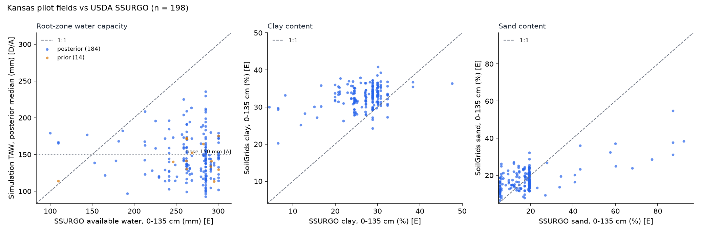

# Independent soil check: Kansas pilot fields vs USDA SSURGO

Generated by `scripts/check_ssurgo.py`. Read-only check; no simulation input changed.
Root zone 0-135 cm (mean of FAO-56 Table 22 maize root depth range (config/crops.yaml)). Point: field centroid (representative point if outside the polygon). SSURGO: component-percent weighted over components with complete awc_r. AWS_mm = 10 * sum(awc_r [cm/cm] * horizon thickness inside root zone [cm]). Differences are pipeline/SoilGrids minus SSURGO.

Fields: 200; SSURGO value found: 198.

| Comparison | n | Pearson r | Spearman rho | Mean bias | Median bias | MAE |
|---|---|---|---|---|---|---|
| Simulation TAW (all fields) vs SSURGO AWS | 198 | -0.087 | -0.118 | -119.26 | -128.44 | 121.58 (mm) |
| Simulation TAW (posterior fields only) | 184 | -0.117 | -0.125 | -119.38 | -128.71 | 121.84 (mm) |
|   sensitivity: dominant component | 198 | -0.085 | -0.113 | -118.83 | -129.0 | 121.7 (mm) |
|   sensitivity: root zone 100 cm | 198 | -0.098 | -0.104 | -48.91 | -55.79 | 56.17 (mm) |
| Base TAW 150 mm (constant) vs SSURGO AWS | 198 | None | None | -116.06 | -132.12 | 117.85 (mm) |
| SoilGrids clay vs SSURGO clay | 198 | 0.324 | 0.206 | 5.98 | 5.25 | 6.31 (% (weight, < 2 mm)) |
| SoilGrids sand vs SSURGO sand | 198 | 0.647 | 0.346 | -0.66 | 1.27 | 7.24 (% (weight, < 2 mm)) |

SSURGO AWS over the root zone (mm): {'mean': 266.1, 'std': 36.1, 'min': 100.1, '10%': 229.5, '50%': 282.1, '90%': 295.3, 'max': 300.6}

Fields with no SSURGO value:

- no awc_r over the full root zone (profile too shallow or null awc_r): 2 (189e236596fa05b85f1c19fe582083601b59b353, 71b9fde5a3ad92f14651b86b82ecff517e1d8cce)

